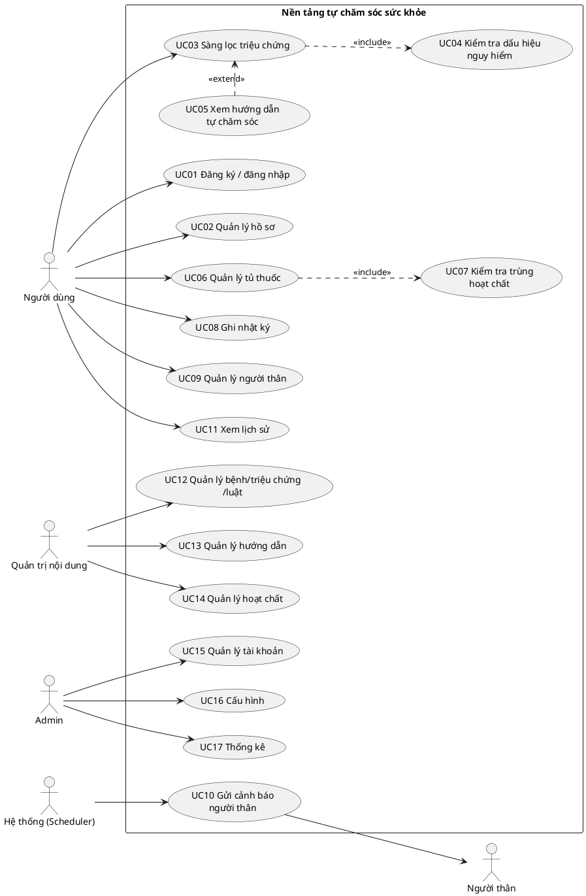
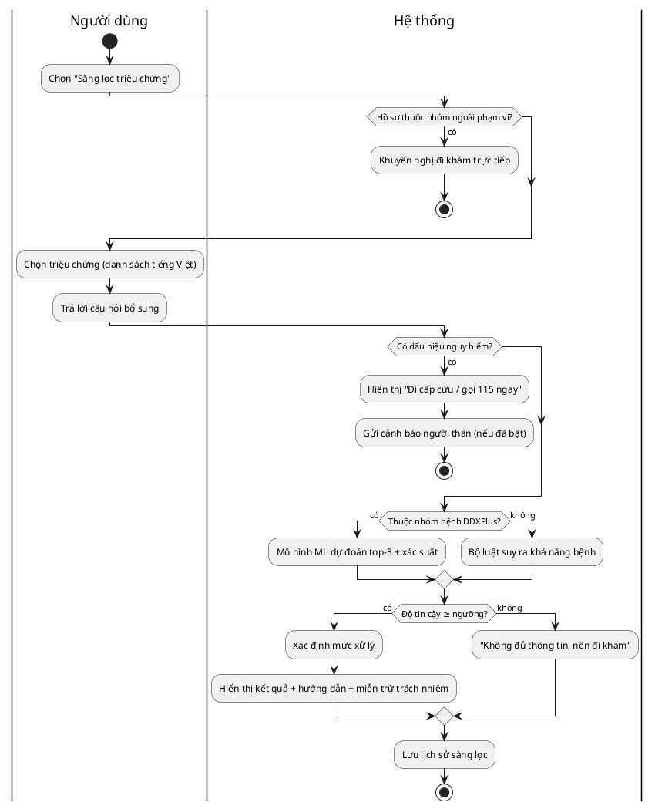
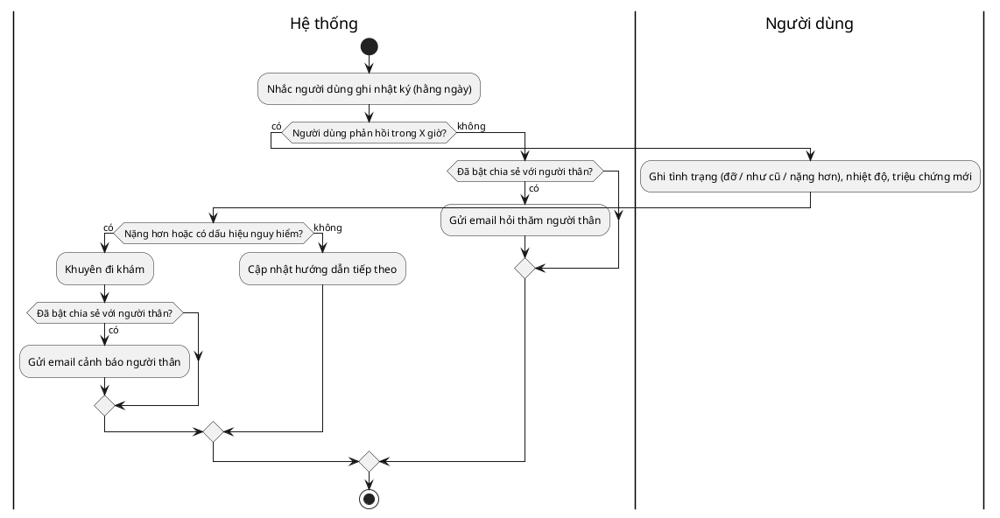

# PHÂN TÍCH NGHIỆP VỤ

**Đề tài:** Nền tảng hỗ trợ tự chăm sóc sức khỏe tại nhà cho người sống một mình: sàng lọc triệu chứng, hướng dẫn chăm sóc và cảnh báo người thân, tích hợp Học máy

---

## 1. Bối cảnh và vấn đề

### 1.1 Bối cảnh
Ở các thành phố lớn, số người sống một mình ngày càng nhiều: sinh viên ở trọ, người đi làm xa nhà, người độc thân. Khi bị ốm vặt (cảm cúm, đau họng, sổ mũi, rối loạn tiêu hóa nhẹ...), nhóm này thường:
- Ngại ra ngoài đi khám vì mệt, tốn thời gian và chi phí.
- Tự tra Google, gặp thông tin trôi nổi, thiếu tin cậy và dễ hoang mang.
- Tự mua thuốc theo kinh nghiệm.
- Không có ai bên cạnh theo dõi khi bệnh chuyển nặng.

### 1.2 Vấn đề cần giải quyết
| # | Vấn đề | Hậu quả |
|---|---|---|
| V1 | Không biết bệnh có nghiêm trọng không | Chủ quan bỏ qua dấu hiệu nguy hiểm, hoặc lo lắng thái quá |
| V2 | Không biết cách tự chăm sóc đúng | Ăn uống, nghỉ ngơi sai, bệnh lâu khỏi |
| V3 | Dùng thuốc không kiểm soát | Uống trùng hoạt chất (ví dụ nhiều thuốc cùng chứa paracetamol), nguy cơ quá liều |
| V4 | Không ai biết khi bệnh trở nặng | Chậm trễ xử lý |

### 1.3 Mục tiêu của hệ thống
- **MT1:** Sàng lọc triệu chứng: gợi ý các khả năng bệnh thường gặp và **mức độ cần xử lý**.
- **MT2:** Phát hiện sớm **dấu hiệu nguy hiểm** và khuyên đi khám hoặc cấp cứu ngay.
- **MT3:** Cung cấp hướng dẫn tự chăm sóc tại nhà đáng tin cậy: nên làm gì, nên ăn và tránh ăn gì, khi nào phải đi khám.
- **MT4:** Giúp quản lý tủ thuốc cá nhân và cảnh báo trùng hoạt chất.
- **MT5:** Theo dõi tình trạng qua nhật ký và **cảnh báo người thân** khi cần.

> **Nguyên tắc cốt lõi:** hệ thống **hỗ trợ sàng lọc**, KHÔNG chẩn đoán, KHÔNG kê đơn, KHÔNG đưa liều thuốc, KHÔNG thay thế bác sĩ.

---

## 2. Phạm vi

### 2.1 Đối tượng sử dụng
- Người trưởng thành **18–60 tuổi**, bình thường khỏe mạnh, sống một mình.
- Không áp dụng cho: trẻ em, người trên 60 tuổi, phụ nữ mang thai, người có bệnh mạn tính nặng. Khi người dùng thuộc nhóm này, hệ thống khuyến nghị đi khám trực tiếp.

### 2.2 Trong phạm vi
- **15 bệnh thường gặp**: 8 bệnh dùng mô hình học máy, 7 bệnh dùng luật (danh sách ở Phụ lục A).
- Nhập triệu chứng bằng cách **chọn từ danh sách tiếng Việt**, không gõ tự do.
- **1 mô hình học máy** train trên bộ dữ liệu **DDXPlus** (bản Figshare 20043374), trả về top-3 khả năng bệnh kèm mức xử lý. Mô hình **học đủ 49 bệnh của DDXPlus**, nhưng chỉ 8 bệnh nhẹ có hướng dẫn tự chăm sóc. Các bệnh còn lại đóng vai trò "lưới an toàn": khi rơi vào top-3 thì hệ thống nâng mức xử lý (xem Phụ lục C).
- Bệnh nằm ngoài DDXPlus dùng **bộ luật** do quản trị nội dung định nghĩa.
- Tủ thuốc gồm **15–20 hoạt chất không kê đơn (OTC)** thông dụng, không có thông tin liều dùng.
- Cảnh báo người thân qua **email**.

### 2.3 Ngoài phạm vi (hướng phát triển)
- Hỏi đáp với chuyên gia, đặt lịch khám.
- Liên kết nhà thuốc, giao thuốc.
- Tư vấn video với bác sĩ.
- Nhập triệu chứng bằng ngôn ngữ tự nhiên hoặc giọng nói.

---

## 3. Tác nhân

| Tác nhân | Mô tả | Quyền / việc chính |
|---|---|---|
| **Người dùng** | Người sống một mình, đối tượng chính | Đăng ký, quản lý hồ sơ sức khỏe, sàng lọc, xem hướng dẫn, quản lý tủ thuốc, ghi nhật ký, quản lý người thân |
| **Người thân** | Người được người dùng thêm vào (bố mẹ, bạn bè...). Không cần tài khoản | Nhận email cảnh báo, xem bản tóm tắt tình trạng qua link (nếu người dùng cho phép) |
| **Quản trị nội dung** | Người soạn tri thức y tế, tham khảo nguồn chính thống | Quản lý bệnh, triệu chứng, dấu hiệu nguy hiểm, luật sàng lọc, hướng dẫn chăm sóc, hoạt chất thuốc |
| **Quản trị viên (Admin)** | Quản lý vận hành hệ thống | Quản lý tài khoản, phân quyền, cấu hình (ngưỡng cảnh báo, thời gian nhắc), xem thống kê |
| **Hệ thống (tác nhân thời gian)** | Tác vụ chạy định kỳ | Nhắc ghi nhật ký, phát hiện người dùng không phản hồi, gửi email cảnh báo |

---

## 4. Quy trình nghiệp vụ

### 4.1 Quy trình hiện tại (As-is), khi chưa có hệ thống
1. Thấy khó chịu trong người → tự tra Google hoặc hỏi bạn bè.
2. Đọc nhiều nguồn mâu thuẫn → tự đoán bệnh.
3. Ra hiệu thuốc mua theo lời kể, hoặc dùng thuốc còn trong nhà.
4. Bệnh nặng lên → tự xoay xở, người thân thường không biết.

**Điểm yếu:** không có bước kiểm tra dấu hiệu nguy hiểm, không kiểm soát thuốc, không ai theo dõi.

### 4.2 Quy trình đề xuất (To-be)

#### QT1 – Sàng lọc triệu chứng
1. Người dùng đăng nhập và chọn "Sàng lọc triệu chứng".
2. Hệ thống kiểm tra hồ sơ: nếu thuộc nhóm ngoài phạm vi (tuổi, mang thai, bệnh nền) thì khuyến nghị đi khám trực tiếp.
3. Người dùng chọn các triệu chứng từ danh sách tiếng Việt, được nhóm theo vùng cơ thể.
4. Hệ thống hỏi thêm câu bổ sung: thời gian bị, mức độ, nhiệt độ...
5. **Kiểm tra dấu hiệu nguy hiểm** (luôn làm trước tiên):
   - Nếu có → hiển thị "Cần đi cấp cứu / gọi 115 ngay", gửi cảnh báo người thân (nếu đã bật) → kết thúc.
6. Nếu không có dấu hiệu nguy hiểm:
   - Triệu chứng thuộc nhóm bệnh DDXPlus → **mô hình ML** dự đoán top-3 kèm xác suất.
   - Ngược lại → **bộ luật** suy ra khả năng bệnh.
7. Hệ thống xác định **mức xử lý** và hiển thị kết quả, kèm hướng dẫn chăm sóc và câu miễn trừ trách nhiệm.
8. Lưu lần sàng lọc vào lịch sử.

#### QT2 – Hướng dẫn tự chăm sóc
1. Từ kết quả sàng lọc, hoặc tra cứu trực tiếp theo tên bệnh, người dùng mở hướng dẫn.
2. Hệ thống hiển thị: nên làm gì, nên ăn, nên tránh, các hoạt chất OTC thường dùng (không có liều), và **khi nào phải đi khám**.

#### QT3 – Quản lý tủ thuốc
1. Người dùng thêm thuốc: chọn tên thuốc hoặc nhập tên và chọn các hoạt chất có trong thuốc.
2. Hệ thống kiểm tra: nếu hoạt chất trùng với thuốc khác **đang dùng** thì hiện cảnh báo trùng hoạt chất.
3. Người dùng đánh dấu thuốc đang dùng hoặc đã ngừng, kèm hạn sử dụng. Hệ thống nhắc khi thuốc sắp hết hạn.

#### QT4 – Nhật ký sức khỏe và cảnh báo người thân
1. Trong thời gian đang ốm (sau một lần sàng lọc), hệ thống nhắc người dùng ghi nhật ký hằng ngày.
2. Người dùng ghi nhật ký: cảm thấy thế nào (đỡ / như cũ / nặng hơn), nhiệt độ, triệu chứng mới.
3. Hệ thống đánh giá:
   - Nặng hơn hoặc xuất hiện dấu hiệu nguy hiểm → khuyên đi khám và gửi email cho người thân.
   - Quá **X giờ** (Admin cấu hình) không phản hồi lời nhắc → gửi email hỏi thăm cho người thân.
4. Người thân nhận email gồm tình trạng tóm tắt và gợi ý liên hệ người dùng.

#### QT5 – Quản lý tri thức (Quản trị nội dung)
1. Thêm hoặc sửa bệnh, triệu chứng, quan hệ bệnh–triệu chứng, dấu hiệu nguy hiểm.
2. Soạn hướng dẫn chăm sóc cho từng bệnh, có ghi nguồn tham khảo.
3. Quản lý danh mục hoạt chất và thuốc OTC.

---

## 5. Quy tắc nghiệp vụ

| Mã | Quy tắc |
|---|---|
| BR01 | Kiểm tra **dấu hiệu nguy hiểm luôn chạy trước** mô hình ML hoặc luật. Có dấu hiệu nguy hiểm thì dừng sàng lọc và khuyên đi cấp cứu |
| BR02 | Mọi kết quả sàng lọc là **gợi ý**, luôn kèm câu miễn trừ trách nhiệm. Không dùng từ "chẩn đoán" |
| BR03 | Mức xử lý có 3 cấp: **(1) Tự chăm sóc tại nhà, (2) Nên đi khám trong 24–48 giờ, (3) Đi khám ngay / cấp cứu** |
| BR04 | Người dùng ngoài nhóm đối tượng (dưới 18, trên 60, mang thai, bệnh nền nặng) → luôn khuyên đi khám trực tiếp |
| BR05 | Triệu chứng vượt ngưỡng thời gian hoặc mức độ trong **Phụ lục B** → nâng lên mức xử lý tương ứng |
| BR06 | Kết quả của mô hình phải vượt **ngưỡng tin cậy trong Phụ lục C**. Không đạt → báo "Chưa đủ thông tin để gợi ý, nên đi khám". Bệnh nghiêm trọng xuất hiện trong top-3 → nâng mức xử lý |
| BR14 | Sốt từ ngày thứ 3 trở đi hoặc nghi sốt xuất huyết → cảnh báo **không dùng aspirin, ibuprofen** (nhóm NSAID). Tủ thuốc đánh dấu đỏ các thuốc này |
| BR07 | Hệ thống chỉ chứa thuốc OTC, **không hiển thị liều dùng** |
| BR08 | Hai thuốc **đang dùng** có chung hoạt chất → bắt buộc hiện cảnh báo trùng |
| BR09 | Chỉ gửi cảnh báo cho người thân khi người dùng đã thêm người thân **và bật đồng ý chia sẻ** |
| BR10 | Người thân phải xác nhận qua email trước khi bắt đầu nhận cảnh báo |
| BR11 | Mỗi lần sàng lọc đều được lưu lại (triệu chứng, kết quả, thời điểm) để theo dõi và đánh giá |
| BR12 | Nội dung y tế phải có nguồn tham khảo, và chỉ quản trị nội dung được sửa |
| BR13 | Dữ liệu sức khỏe là dữ liệu nhạy cảm: chỉ chủ tài khoản xem được. Người thân chỉ thấy bản tóm tắt được cho phép |

---

## 6. Yêu cầu chức năng (Use case)

| Mã | Use case | Tác nhân | Ưu tiên |
|---|---|---|---|
| UC01 | Đăng ký / đăng nhập / quên mật khẩu | Người dùng | Cao |
| UC02 | Quản lý hồ sơ sức khỏe (tuổi, giới tính, bệnh nền, dị ứng thuốc) | Người dùng | Cao |
| UC03 | Sàng lọc triệu chứng | Người dùng | **Lõi** |
| UC04 | Kiểm tra dấu hiệu nguy hiểm (include UC03) | Hệ thống | **Lõi** |
| UC05 | Xem hướng dẫn tự chăm sóc | Người dùng | **Lõi** |
| UC06 | Quản lý tủ thuốc | Người dùng | **Lõi** |
| UC07 | Kiểm tra trùng hoạt chất (include UC06) | Hệ thống | **Lõi** |
| UC08 | Ghi nhật ký sức khỏe | Người dùng | **Lõi** |
| UC09 | Quản lý người thân | Người dùng | Cao |
| UC10 | Gửi cảnh báo / hỏi thăm người thân | Hệ thống | **Lõi** |
| UC11 | Xem lịch sử sàng lọc và nhật ký | Người dùng | Trung bình |
| UC12 | Quản lý bệnh, triệu chứng, dấu hiệu nguy hiểm, luật | Quản trị nội dung | Cao |
| UC13 | Quản lý hướng dẫn chăm sóc | Quản trị nội dung | Cao |
| UC14 | Quản lý hoạt chất, thuốc OTC | Quản trị nội dung | Cao |
| UC15 | Quản lý tài khoản, phân quyền | Admin | Trung bình |
| UC16 | Cấu hình hệ thống (ngưỡng, thời gian nhắc) | Admin | Trung bình |
| UC17 | Xem thống kê (số lượt sàng lọc, bệnh phổ biến) | Admin | Thấp |

---

## 7. Yêu cầu phi chức năng

| Mã | Yêu cầu |
|---|---|
| NFR01 | **An toàn:** câu miễn trừ trách nhiệm luôn hiển thị; kiểm tra dấu hiệu nguy hiểm không được bỏ qua |
| NFR02 | **Bảo mật:** mật khẩu được băm (bcrypt), phân quyền theo vai trò, dữ liệu sức khỏe chỉ chủ tài khoản truy cập |
| NFR03 | **Hiệu năng:** kết quả sàng lọc trả về trong vòng 2 giây |
| NFR04 | **Dễ dùng:** giao diện tiếng Việt, đơn giản, dùng tốt trên điện thoại (người đang ốm, mệt) |
| NFR05 | **Chất lượng mô hình:** trên tập test DDXPlus: top-1 ≥ 90%, top-3 ≥ 97%, **độ nhạy (recall) nhóm "cần đi khám" ≥ 98%**. Ngoài ra kiểm thử thêm trên 30 ca tự soạn bằng tiếng Việt (xem Phụ lục C) |
| NFR06 | **Dễ bảo trì:** tri thức (bệnh, luật, hướng dẫn) nằm trong cơ sở dữ liệu, sửa được mà không cần sửa code |

---

## 8. Sơ đồ UML

### 8.1 Sơ đồ use case tổng quát

### 8.2 Sơ đồ hoạt động – Sàng lọc triệu chứng

### 8.3 Sơ đồ hoạt động – Nhật ký và cảnh báo người thân

---

## 9. Thuật ngữ

| Thuật ngữ | Giải thích |
|---|---|
| Sàng lọc | Đánh giá sơ bộ để gợi ý khả năng bệnh và mức độ cần xử lý; không phải chẩn đoán |
| Dấu hiệu nguy hiểm (red flag) | Triệu chứng cho thấy cần được y tế can thiệp ngay |
| Hoạt chất | Thành phần có tác dụng chữa bệnh trong thuốc (ví dụ paracetamol) |
| OTC | Thuốc không cần kê đơn |
| DDXPlus | Bộ dữ liệu bệnh nhân tổng hợp (Mila, 2022), dùng để train mô hình chẩn đoán phân biệt |
| Top-3 accuracy | Tỉ lệ bệnh đúng nằm trong 3 kết quả đầu tiên mô hình trả về |

---

## 10. Giả định và ràng buộc
- Người dùng khai triệu chứng trung thực và đầy đủ.
- DDXPlus là dữ liệu tổng hợp, không phải bệnh nhân Việt Nam. Vì vậy cần việt hóa và đối chiếu triệu chứng.
- Nội dung hướng dẫn tham khảo nguồn chính thống: Bộ Y tế, WHO, các bệnh viện lớn.
- Đề tài phục vụ mục đích học tập và demo, chưa đưa vào sử dụng thật.

---

## Phụ lục A – Danh sách 15 bệnh

### A.1 Nhóm dùng mô hình học máy (có trong DDXPlus)
| STT | Bệnh | Tên trong DDXPlus | Mức xử lý mặc định |
|---|---|---|---|
| 1 | Cảm lạnh (nhiễm trùng hô hấp trên) | URTI | 1 |
| 2 | Viêm họng do virus | Viral pharyngitis | 1 |
| 3 | Cúm | Influenza | 1 (lên 2 nếu sốt kéo dài) |
| 4 | Viêm mũi xoang cấp | Acute rhinosinusitis | 1 |
| 5 | Viêm mũi xoang dị ứng | Allergic sinusitis | 1 |
| 6 | Viêm thanh quản cấp | Acute laryngitis | 1 |
| 7 | Viêm phế quản cấp | Bronchitis | 1 (lên 2 nếu ho kéo dài hoặc khó thở) |
| 8 | Trào ngược dạ dày thực quản | GERD | 1 (lên 2 nếu tái diễn nhiều tuần) |

### A.2 Nhóm dùng luật (không có trong DDXPlus)
| STT | Bệnh | Mức xử lý mặc định |
|---|---|---|
| 9 | Viêm dạ dày ruột cấp (tiêu chảy cấp, ngộ độc thực phẩm nhẹ) | 1 |
| 10 | Khó tiêu chức năng, đầy hơi | 1 |
| 11 | Táo bón | 1 |
| 12 | Đau đầu do căng thẳng | 1 |
| 13 | Viêm kết mạc (đau mắt đỏ) | 1 (lên 2 nếu đau nhức mắt hoặc nhìn mờ) |
| 14 | Mề đay cấp, dị ứng da | 1 (lên 3 nếu sưng môi hoặc khó thở) |
| 15 | Sốt xuất huyết Dengue – *nhóm cảnh giác* | **Luôn ≥ 2** |

### A.3 Lý do chọn
- **Tiêu chí chọn:** bệnh (1) hay gặp ở người lớn tại Việt Nam, (2) đa số tự khỏi hoặc tự chăm sóc được, (3) có hướng dẫn chính thống để dẫn nguồn.
- **8 bệnh nhóm ML** là các bệnh nhẹ của DDXPlus. Bộ dữ liệu này có nhiều ca URTI và Viral pharyngitis, nên mô hình có đủ dữ liệu để học.
- **Nhóm luật bù phần DDXPlus không có.** DDXPlus gần như không có bệnh tiêu hóa thường gặp, mắt và da. Đây lại là những bệnh người sống một mình hay gặp (ăn uống thất thường, đồ ăn ngoài).
- **Sốt xuất huyết** là bệnh lưu hành ở Việt Nam. Giai đoạn đầu dễ nhầm với cảm cúm, và người bệnh tuyệt đối không được dùng aspirin hay ibuprofen. Đưa bệnh này vào giúp tính năng tủ thuốc có giá trị thật (BR14). Đồng thời đây là điểm khác biệt "Việt Nam hóa" so với một app nước ngoài.
- **Các bệnh nhẹ của DDXPlus bị loại:**
  - Viêm tai giữa cấp: chủ yếu gặp ở trẻ em, người lớn cần đi soi tai.
  - Cơn hoảng loạn (panic attack): thuộc sức khỏe tâm thần, không phù hợp tự chăm sóc bằng app.
  - Ngộ độc cá scombroid: hiếm gặp, triệu chứng trùng với dị ứng.

---

## Phụ lục B – Ngưỡng thời gian, mức độ và dấu hiệu nguy hiểm

### B.1 Ngưỡng nâng mức xử lý
| Triệu chứng | Ngưỡng | Mức | Lý do / nguồn |
|---|---|---|---|
| Sốt (≥ 38°C) | Kéo dài **≥ 3 ngày** | 2 | HSE (Ireland) khuyên đi khám nếu vẫn sốt sau 3 ngày. Ở Việt Nam, sốt từ ngày thứ 3 còn là lúc cần nghĩ tới sốt xuất huyết |
| Sốt | **≥ 40°C** | 2 | HSE xếp ≥ 40°C là sốt rất cao, cần liên hệ bác sĩ |
| Ho | Kéo dài **> 2 tuần** | 2 | Bộ Y tế (QĐ 3126/QĐ-BYT) coi ho trên 2 tuần là triệu chứng nghi lao quan trọng nhất. Chọn mốc này thay vì 3 tuần của NHS vì Việt Nam có gánh nặng lao cao |
| Ho ra máu | Bất kỳ | 3 | NHS: cần khám khẩn |
| Nôn | Kéo dài **> 2 ngày** hoặc không giữ được nước | 2 / 3 | NHS: nôn quá 2 ngày cần đi khám |
| Tiêu chảy | Kéo dài **> 7 ngày** | 2 | NHS: tiêu chảy cấp thường hết trong 5–7 ngày |
| Tiêu chảy | Có máu, hoặc có dấu hiệu mất nước | 3 | NHS: cần khám khẩn |
| Bất kỳ | Người dùng ghi "nặng hơn" 2 ngày liên tiếp | 2 | Diễn tiến xấu là dấu hiệu chung trong hướng dẫn của NHS |

### B.2 Dấu hiệu nguy hiểm → mức 3 (kiểm tra đầu tiên, BR01)
Khó thở hoặc thở rít; đau tức ngực; lơ mơ, lú lẫn, co giật; cứng cổ kèm sốt; xuất huyết (chảy máu chân răng, chảy máu cam, chấm xuất huyết dưới da, nôn ra máu, phân đen); đau bụng dữ dội; sưng môi, lưỡi hoặc mặt; ngất; tiểu rất ít kèm môi khô (mất nước nặng).

### B.3 Nhắc nhật ký và cảnh báo người thân
| Thông số | Giá trị | Lý do |
|---|---|---|
| Giờ nhắc | **8:00 và 20:00**, chỉ trong thời gian đang ốm | 2 lần/ngày đủ để theo dõi diễn tiến mà không gây phiền |
| Không phản hồi (đang ở mức 1) | **24 giờ** → email hỏi thăm người thân | Dưới 12 giờ dễ báo nhầm vì người dùng ngủ hoặc bận. 24 giờ bằng một chu kỳ "check-in" mỗi ngày |
| Không phản hồi (đang ở mức 2) | **12 giờ** → email người thân | Người có nguy cơ cao thì cần biết sớm hơn |
| Mức 3 | **Gửi ngay** | Không chờ |
| Giờ yên lặng | 22:00–7:00 không gửi email hỏi thăm (trừ mức 3) | Tránh làm người thân hoảng lúc nửa đêm vì người dùng chỉ đang ngủ |

Tất cả giá trị trên đều để trong bảng `cau_hinh`, Admin sửa được (NFR06).

---

## Phụ lục C – Ngưỡng tin cậy và mục tiêu mô hình

### C.1 Quy tắc dùng xác suất của mô hình
1. **Bệnh nghiêm trọng trong top-3:** DDXPlus gán cho mỗi bệnh một mức nghiêm trọng (trường `severity` trong `release_conditions.json`).
   - Bệnh rất nặng có xác suất ≥ **0,10** → mức 3.
   - Các bệnh khác ngoài 15 bệnh trong phạm vi có tổng xác suất ≥ **0,15** → mức 2.
2. **Hiển thị kết quả** chỉ khi top-1 ≥ **0,50**. Nếu không đạt → "Chưa đủ thông tin". Hệ thống hỏi thêm triệu chứng, hoặc khuyên đi khám.

**Lý do:**
- **Ngưỡng cho bệnh nghiêm trọng đặt thấp vì chi phí hai loại sai khác nhau:** bỏ sót bệnh nặng nguy hiểm hơn nhiều so với khuyên đi khám thừa. Hệ thống sàng lọc ưu tiên **độ nhạy** hơn độ chính xác.
- **Tại sao phải học đủ 49 bệnh:** nếu mô hình chỉ học 8 bệnh nhẹ, người bị viêm phổi vẫn bị **ép** vào một trong 8 bệnh nhẹ, ví dụ "viêm phế quản". Học thêm các bệnh nặng giúp mô hình "biết khi nào ca này không phải bệnh nhẹ".
- **Các con số 0,10 / 0,15 / 0,50 chỉ là giá trị khởi đầu.** Sau khi train, chỉnh lại trên tập validation sao cho độ nhạy của nhóm cần đi khám ≥ 98%.

### C.2 Mục tiêu đánh giá
| Chỉ số | Mục tiêu | Lý do |
|---|---|---|
| Top-1 accuracy (test DDXPlus) | ≥ 90% | DDXPlus là dữ liệu tổng hợp. Các mô hình đã công bố đạt gần 99% (DDxT báo cáo 99,98%) |
| Top-3 accuracy (test DDXPlus) | ≥ 97% | Như trên |
| Recall nhóm "cần đi khám" | ≥ 98% | Chỉ số quan trọng nhất về an toàn |
| 30 ca tự soạn tiếng Việt | Báo cáo số ca đúng mức xử lý | Kiểm tra khi chỉ dùng các triệu chứng đã việt hóa, gần với cách người dùng thật nhập |

**Vì sao không giữ mục tiêu 85%:**
- Trên DDXPlus, 85% là quá thấp, vì mô hình đơn giản cũng đạt trên 90%.
- Mình vẫn đặt mục tiêu thấp hơn mức 99% của các bài báo, vì hệ thống chỉ dùng phần triệu chứng đã việt hóa (có thể bỏ bớt một số tiền sử) và dùng mô hình đơn giản (Random Forest / LightGBM).
- Khi bảo vệ cần nói rõ: **điểm cao trên dữ liệu tổng hợp không có nghĩa là chính xác ngoài đời.** Đó là lý do có thêm bộ 30 ca tiếng Việt và câu miễn trừ trách nhiệm (BR02).

### C.3 Nguồn tham khảo
- Bộ Y tế, QĐ 3126/QĐ-BYT – Hướng dẫn chẩn đoán, điều trị và dự phòng bệnh lao.
- Bộ Y tế, QĐ 2760/QĐ-BYT (2023) – Hướng dẫn chẩn đoán, điều trị sốt xuất huyết Dengue.
- NHS / NI Direct – Cough; Diarrhoea and vomiting.
- HSE (Ireland) – Fever in adults.
- Fansi Tchango et al., *DDXPlus: A New Dataset For Automatic Medical Diagnosis*, NeurIPS 2022.
- *DDxT* (arXiv 2312.01242) – kết quả trên DDXPlus.
