# PHÂN TÍCH HỆ THỐNG VÀ BIỂU DIỄN UML

**Đề tài:** Nền tảng hỗ trợ tự chăm sóc sức khỏe tại nhà cho người sống một mình: sàng lọc triệu chứng, hướng dẫn chăm sóc và cảnh báo người thân, tích hợp Học máy

---

## 0. Những điểm điều chỉnh so với Phân tích nghiệp vụ v1.1

Khi chi tiết hóa thành sơ đồ hệ thống, có một số chỗ bản v1.1 chưa đủ rõ để code. Các điểm dưới đây là **đề xuất**. Nếu đồng ý thì cập nhật vào nghiệp vụ v1.2.

| Mã | Điều chỉnh | Lý do |
|---|---|---|
| Đ1 | **Mô hình ML và bộ luật chạy song song** rồi gộp kết quả, thay vì rẽ nhánh "thuộc nhóm DDXPlus → ML, ngược lại → luật" | Trước khi chạy thì không biết được ca này "thuộc nhóm DDXPlus" hay không. Quan trọng hơn: sốt xuất huyết (luật) giai đoạn đầu rất giống cúm (ML). Nếu rẽ nhánh thì ca sốt xuất huyết dễ bị đưa sang ML và bỏ sót |
| Đ2 | **Kiểm tra "lưới an toàn" trước ngưỡng 0,50** | Sơ đồ 8.2 của v1.1 xét ngưỡng tin cậy trước. Như vậy, một ca có top-1 < 0,50 nhưng viêm phổi chiếm 0,20 sẽ chỉ nhận thông báo "chưa đủ thông tin" thay vì mức 3 |
| Đ3 | Thêm khái niệm **Đợt ốm** (từ lần sàng lọc đầu tiên đến khi khỏi). Nhắc nhật ký, mức xử lý và cảnh báo người thân đều gắn với đợt ốm | QT4 nói "trong thời gian đang ốm" nhưng chưa định nghĩa lúc nào bắt đầu và lúc nào kết thúc |
| Đ4 | Thêm quy tắc **BR15–BR20** (bảng dưới) | Cần để vẽ được sơ đồ trạng thái và sơ đồ tuần tự |
| Đ5 | Email cảnh báo người thân gửi khi **mức xử lý tăng** (lên 2 hoặc 3). Một lần ghi "nặng hơn" chưa vượt ngưỡng thì chỉ hiện lời khuyên theo dõi sát | QT4 (nặng hơn → gửi email) mâu thuẫn với B.1 (nặng hơn 2 ngày liên tiếp → mức 2). Gửi ngay từ lần đầu dễ làm người thân lo không cần thiết |
| Đ6 | Sơ đồ use case: thêm liên kết Người dùng → UC05 (tra cứu trực tiếp), thêm tác nhân phụ **Dịch vụ email** | Bản v1.1 chỉ có UC05 mở rộng từ UC03, thiếu đường tra cứu theo tên bệnh (QT2 bước 1) |

### Quy tắc nghiệp vụ bổ sung (đề xuất)
| Mã | Quy tắc |
|---|---|
| BR15 | Mỗi người dùng có **tối đa 1 đợt ốm đang mở**. Sàng lọc mới trong khi đợt ốm đang mở thì gắn vào đợt đó |
| BR16 | Trong một đợt ốm, mức xử lý **chỉ tăng, không tự giảm** (vì an toàn). Người dùng muốn "hạ mức" thì kết thúc đợt (đã khỏi hoặc đã đi khám) |
| BR17 | Đợt ốm kết thúc khi người dùng chọn **"Đã khỏi"** hoặc **"Đã đi khám"**. Quá **14 ngày** thì hệ thống tự đóng đợt và khuyên đi khám (khớp mốc ho > 2 tuần) |
| BR18 | Mốc tính "không phản hồi" = thời điểm ghi nhật ký gần nhất, hoặc lúc mở đợt nếu chưa có nhật ký. **Mỗi khoảng không phản hồi chỉ gửi 1 email hỏi thăm** |
| BR19 | **Không hiển thị tên bệnh nặng nằm ngoài phạm vi** (ví dụ viêm phổi). Chỉ hiển thị mức xử lý và thông điệp "triệu chứng cần được bác sĩ đánh giá" |
| BR20 | Mỗi người dùng có **tối đa 3 người thân**. Link xác nhận hết hạn sau **72 giờ**. Mọi email gửi người thân đều có link **hủy nhận** |

> BR19: lý do là để tránh gây hoang mang và tránh việc hệ thống trông như đang "chẩn đoán" một bệnh nặng (BR02).

---

## 1. Tổng quan hệ thống

### 1.1 Các thành phần logic
Đây là phân chia ở mức **phân tích**, dùng làm các "lifeline" trong sơ đồ tuần tự. Công nghệ cụ thể và cách triển khai sẽ chốt ở Giai đoạn 3 (Thiết kế).

| Thành phần | Trách nhiệm |
|---|---|
| Giao diện web | Màn hình cho Người dùng, Quản trị nội dung, Admin; trang tóm tắt cho Người thân |
| Các controller | Nhận yêu cầu, kiểm tra quyền, gọi dịch vụ |
| Dịch vụ sàng lọc | Điều phối toàn bộ UC03 |
| Bộ kiểm tra dấu hiệu nguy hiểm | So triệu chứng với danh sách red flag (BR01) |
| Dịch vụ ML | Nhận vector triệu chứng → trả xác suất 49 bệnh DDXPlus |
| Bộ máy luật | Đánh giá 7 bệnh dùng luật |
| Bộ đánh giá mức xử lý | Áp Phụ lục B, C → ra mức 1/2/3 và danh sách hiển thị |
| Dịch vụ tủ thuốc | Thêm thuốc, kiểm tra trùng hoạt chất, cảnh báo NSAID |
| Dịch vụ theo dõi | Quản lý đợt ốm, nhật ký, phát hiện không phản hồi |
| Dịch vụ thông báo | Tạo và gửi email (nhắc, hỏi thăm, cảnh báo, xác nhận) |
| Bộ hẹn giờ (Scheduler) | Chạy định kỳ 15 phút một lần |
| CSDL | Lưu tri thức, dữ liệu người dùng, cấu hình |

### 1.2 Sơ đồ ngữ cảnh
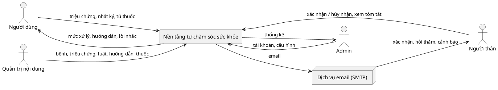

---

## 2. Sơ đồ use case phân rã

### 2.1 Phân hệ Người dùng
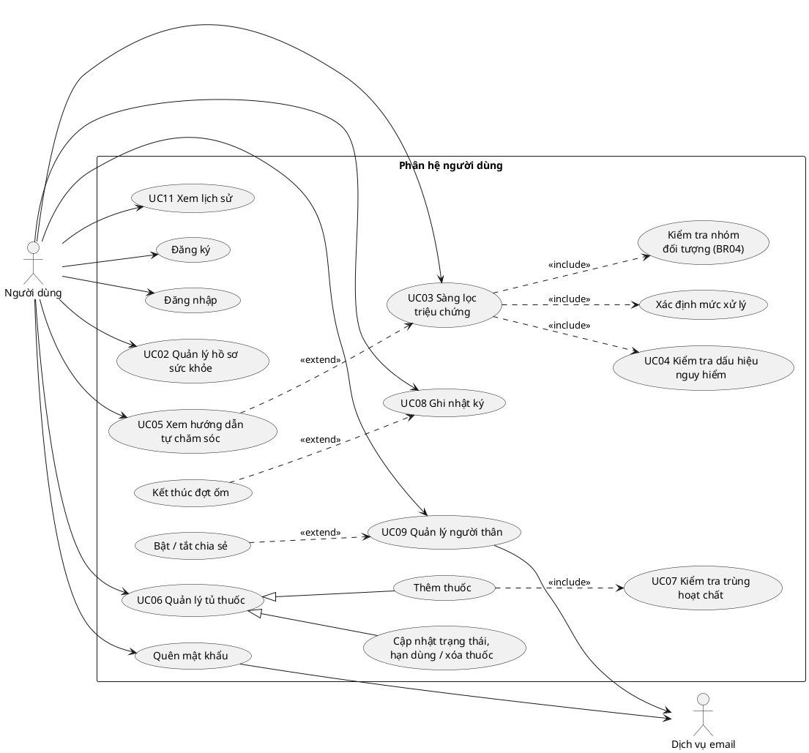

### 2.2 Phân hệ quản trị
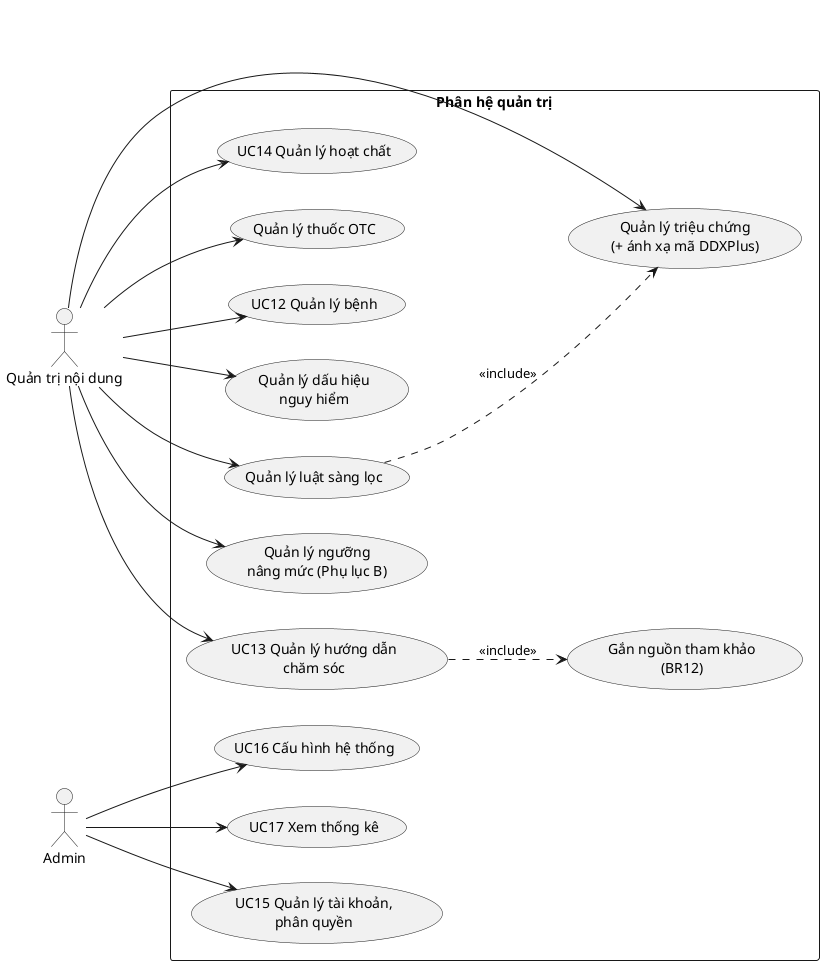

### 2.3 Phân hệ tự động (tác nhân thời gian)
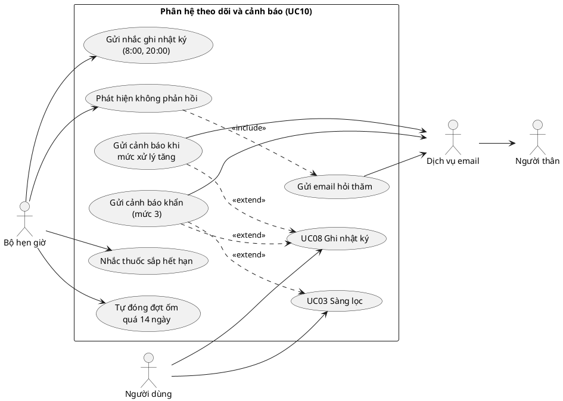

---

## 3. Đặc tả use case

### 3.1 UC03 – Sàng lọc triệu chứng (lõi)
| Mục | Nội dung |
|---|---|
| Tác nhân chính | Người dùng |
| Tác nhân phụ | Dịch vụ email (khi có cảnh báo khẩn) |
| Mục tiêu | Nhận gợi ý khả năng bệnh, mức xử lý và hướng dẫn tự chăm sóc |
| Tiền điều kiện | Đã đăng nhập; hồ sơ đã có ngày sinh và giới tính |
| Hậu điều kiện | Lần sàng lọc được lưu (BR11); đợt ốm được mở hoặc cập nhật (BR15, BR16) |
| Quy tắc liên quan | BR01–BR06, BR11, BR14, BR15, BR16, BR19; NFR01, NFR03 |

**Luồng chính**
1. Người dùng chọn "Sàng lọc triệu chứng".
2. Hệ thống đọc hồ sơ sức khỏe và kiểm tra nhóm đối tượng.
3. Hệ thống hiển thị danh sách triệu chứng tiếng Việt, nhóm theo vùng cơ thể.
4. Người dùng chọn triệu chứng.
5. Hệ thống hiển thị câu hỏi bổ sung theo triệu chứng đã chọn (số ngày bị, nhiệt độ cao nhất, mức độ, có máu không...). Người dùng trả lời.
6. Hệ thống kiểm tra dấu hiệu nguy hiểm → không có.
7. Hệ thống chạy song song: mô hình ML (nếu có ít nhất 1 triệu chứng ánh xạ được sang DDXPlus) và bộ luật.
8. Hệ thống xác định mức xử lý và danh sách bệnh hiển thị (mục 4.2).
9. Hệ thống hiển thị: tối đa 3 khả năng bệnh, mức xử lý, nút xem hướng dẫn (UC05), cảnh báo NSAID nếu có, và câu miễn trừ trách nhiệm.
10. Hệ thống lưu lần sàng lọc và mở hoặc cập nhật đợt ốm.

**Luồng thay thế**
- **A1 (bước 2) – Ngoài nhóm đối tượng:** hiển thị khuyến nghị đi khám trực tiếp, kết thúc. Lần này không lưu thành lần sàng lọc.
- **A2 (bước 6) – Có dấu hiệu nguy hiểm:** mức = 3, hiển thị "Đi cấp cứu / gọi 115 ngay" và bỏ qua bước 7–8. Nếu thỏa BR09 thì gửi cảnh báo khẩn cho người thân. Tiếp tục bước 10.
- **A3 (bước 8) – Không có bệnh nào để hiển thị:** mức ≥ 2, hiển thị "Chưa đủ thông tin để gợi ý, nên đi khám".
- **A4 (bước 10) – Đang có đợt ốm mở:** gắn lần sàng lọc vào đợt đó; mức của đợt = max(mức cũ, mức mới).
- **A5 (bước 9) – Mức 3 do lưới an toàn ML:** không hiện tên bệnh nặng (BR19), chỉ hiện thông điệp đi khám ngay. Nếu thỏa BR09 thì gửi cảnh báo khẩn.

**Ngoại lệ**
- **E1 – Chưa có hồ sơ:** chuyển tới UC02.
- **E2 – Dịch vụ ML lỗi hoặc quá 2 giây:** vẫn chạy luật và ngưỡng Phụ lục B. Nếu không có kết quả luật thì xử lý như A3. Ghi log lỗi. *(Không bao giờ để lỗi kỹ thuật dẫn tới kết quả "tự chăm sóc".)*

### 3.2 UC06 + UC07 – Quản lý tủ thuốc, kiểm tra trùng hoạt chất
| Mục | Nội dung |
|---|---|
| Tác nhân chính | Người dùng |
| Tiền điều kiện | Đã đăng nhập |
| Hậu điều kiện | Thuốc được lưu trong tủ, kèm cờ "đã xác nhận trùng" nếu có |
| Quy tắc liên quan | BR07, BR08, BR14 |

**Luồng chính (Thêm thuốc)**
1. Người dùng chọn "Thêm thuốc".
2. Người dùng chọn thuốc từ danh mục OTC. Hệ thống tự điền các hoạt chất.
3. Người dùng nhập hạn sử dụng và chọn trạng thái "Đang dùng" hoặc "Dự trữ".
4. Nếu trạng thái là "Đang dùng", hệ thống so hoạt chất với các thuốc đang dùng khác → không trùng.
5. Hệ thống lưu thuốc và hiển thị tủ thuốc đã cập nhật.

**Luồng thay thế**
- **A1 (bước 2) – Thuốc không có trong danh mục:** người dùng nhập tên thuốc và chọn hoạt chất từ danh mục hoạt chất.
- **A2 (bước 4) – Có hoạt chất trùng:** hiển thị cảnh báo, nêu tên hoạt chất và thuốc bị trùng. Người dùng chọn "Hủy" (kết thúc) hoặc "Vẫn thêm" (lưu với cờ đã xác nhận).
- **A3 – Đợt ốm đang có cờ NSAID và thuốc chứa aspirin hoặc ibuprofen:** đánh dấu đỏ và hiện cảnh báo (BR14).
- **A4 – Chuyển thuốc từ "Dự trữ" sang "Đang dùng":** chạy lại bước 4.

### 3.3 UC08 – Ghi nhật ký sức khỏe
| Mục | Nội dung |
|---|---|
| Tác nhân chính | Người dùng |
| Tiền điều kiện | Có đợt ốm đang mở |
| Hậu điều kiện | Nhật ký được lưu; mốc không phản hồi được đặt lại; mức của đợt có thể tăng |
| Quy tắc liên quan | BR01, BR05, BR09, BR16, BR17, BR18 |

**Luồng chính**
1. Người dùng mở nhật ký (từ lời nhắc hoặc tự vào).
2. Người dùng chọn cảm nhận: Đỡ / Như cũ / Nặng hơn. Nhập nhiệt độ và triệu chứng mới (nếu có).
3. Hệ thống lưu và đặt lại mốc không phản hồi.
4. Hệ thống đánh giá: không có dấu hiệu nguy hiểm, không vượt ngưỡng → hiển thị hướng dẫn tiếp theo.

**Luồng thay thế**
- **A1 (bước 4) – Có dấu hiệu nguy hiểm:** mức = 3, khuyên cấp cứu, gửi cảnh báo khẩn ngay (kể cả giờ yên lặng).
- **A2 (bước 4) – Nặng hơn 2 ngày liên tiếp hoặc vượt ngưỡng Phụ lục B:** mức = max(mức, 2), khuyên đi khám trong 24–48 giờ, gửi email cảnh báo người thân (hoãn đến 7:00 nếu đang giờ yên lặng).
- **A3 – Người dùng chọn "Đã khỏi" hoặc "Đã đi khám":** kết thúc đợt ốm, ngừng nhắc.

### 3.4 UC09 – Quản lý người thân
| Mục | Nội dung |
|---|---|
| Tác nhân chính | Người dùng |
| Tác nhân phụ | Người thân, Dịch vụ email |
| Hậu điều kiện | Người thân ở trạng thái "Chờ xác nhận"; sau khi xác nhận thì nhận được cảnh báo |
| Quy tắc liên quan | BR09, BR10, BR13, BR20 |

**Luồng chính**
1. Người dùng nhập họ tên, email, quan hệ; chọn có đồng ý chia sẻ không và có cho xem tóm tắt không.
2. Hệ thống kiểm tra giới hạn 3 người.
3. Hệ thống lưu ở trạng thái "Chờ xác nhận" và gửi email mời kèm link có hạn 72 giờ.
4. Người thân bấm link → hệ thống chuyển sang "Đã xác nhận".

**Luồng thay thế**
- **A1 – Đã đủ 3 người:** báo lỗi, không lưu.
- **A2 – Link hết hạn:** trạng thái "Hết hạn". Người dùng có thể gửi lại lời mời.
- **A3 – Người dùng xóa, hoặc người thân bấm "Hủy nhận" trong email bất kỳ:** trạng thái "Đã hủy", không gửi email nữa.
- **A4 – Người dùng bật hoặc tắt chia sẻ:** chỉ đổi cờ, không cần xác nhận lại.

### 3.5 UC10 – Gửi cảnh báo / hỏi thăm người thân
| Mục | Nội dung |
|---|---|
| Tác nhân chính | Bộ hẹn giờ; hoặc được kích hoạt bởi UC03, UC08 |
| Tác nhân phụ | Dịch vụ email, Người thân |
| Tiền điều kiện | Người thân ở trạng thái "Đã xác nhận" và người dùng đồng ý chia sẻ (BR09, BR10) |
| Quy tắc liên quan | BR09, BR10, BR13, BR18, BR20; Phụ lục B.3 |

**Ba loại email**
| Loại | Khi nào | Giờ yên lặng 22:00–7:00 |
|---|---|---|
| Hỏi thăm | Không phản hồi ≥ 24 giờ (mức 1) hoặc ≥ 12 giờ (mức 2) | Hoãn đến 7:00 |
| Cảnh báo | Mức xử lý tăng lên 2 | Hoãn đến 7:00 |
| Khẩn | Mức 3 (dấu hiệu nguy hiểm hoặc lưới an toàn) | **Gửi ngay** |

**Nội dung email:** tên người dùng, loại thông báo, gợi ý "hãy gọi điện cho ...". Nếu người dùng cho phép thì kèm link xem tóm tắt (mức xử lý, cảm nhận gần nhất, thời điểm phản hồi cuối); link có hạn. **Không** gửi danh sách triệu chứng chi tiết hay tên bệnh (BR13). Luôn có link hủy nhận (BR20).

### 3.6 Đặc tả rút gọn các use case còn lại
| UC | Tiền điều kiện | Luồng chính tóm tắt | Ghi chú / quy tắc |
|---|---|---|---|
| UC01 Đăng ký / đăng nhập / quên mật khẩu | – | Đăng ký bằng email + mật khẩu → xác thực email. Quên mật khẩu → gửi link đặt lại (hạn 30 phút) | NFR02: bcrypt; khóa tạm sau 5 lần sai |
| UC02 Quản lý hồ sơ | Đã đăng nhập | Nhập ngày sinh, giới tính, mang thai, bệnh nền, dị ứng thuốc | Dữ liệu dùng cho BR04 |
| UC05 Xem hướng dẫn | Đã đăng nhập | Từ kết quả sàng lọc hoặc tra theo tên bệnh → hiện nên làm, nên ăn, nên tránh, hoạt chất OTC thường dùng, khi nào đi khám, nguồn | BR07, BR12; chỉ có cho 15 bệnh trong phạm vi |
| UC11 Xem lịch sử | Đã đăng nhập | Danh sách đợt ốm → chi tiết các lần sàng lọc và nhật ký | BR13: chỉ chủ tài khoản |
| UC12 Quản lý tri thức | Vai trò Quản trị nội dung | CRUD bệnh, triệu chứng (kèm mã DDXPlus), red flag, luật, ngưỡng | Luật bắt buộc gắn với triệu chứng đã có |
| UC13 Quản lý hướng dẫn | Vai trò Quản trị nội dung | Soạn và sửa hướng dẫn, bắt buộc gắn ≥ 1 nguồn | BR12; lưu phiên bản và ngày cập nhật |
| UC14 Quản lý hoạt chất, thuốc | Vai trò Quản trị nội dung | CRUD hoạt chất (cờ NSAID), thuốc OTC và hoạt chất của thuốc | BR07: không có trường liều |
| UC15 Quản lý tài khoản | Vai trò Admin | Xem, khóa, mở khóa tài khoản; gán vai trò | Admin **không** xem được dữ liệu sức khỏe (BR13) |
| UC16 Cấu hình | Vai trò Admin | Sửa giờ nhắc, ngưỡng không phản hồi, giờ yên lặng, ngưỡng tin cậy | NFR06 |
| UC17 Thống kê | Vai trò Admin | Số lượt sàng lọc theo ngày, phân bố mức xử lý, bệnh phổ biến | Chỉ số liệu tổng hợp, ẩn danh |

---

## 4. Sơ đồ hoạt động

### 4.1 Sàng lọc triệu chứng (thay thế sơ đồ 8.2 của v1.1)
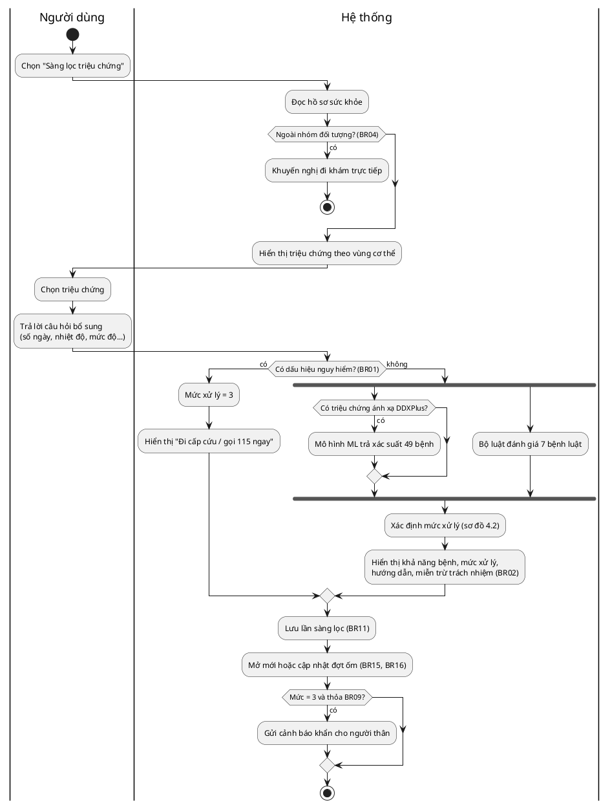

### 4.2 Xác định mức xử lý (hoạt động con)
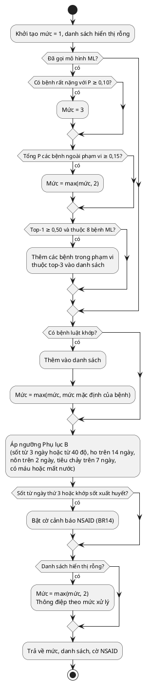

> **Ghi chú:** "bệnh rất nặng" lấy theo trường `severity` trong `release_conditions.json` của DDXPlus. Ngưỡng cụ thể (ví dụ severity ≤ 2) sẽ chốt sau khi đọc file và xem thang đo; cần kiểm tra 1 là nặng nhất hay nhẹ nhất. Bệnh nặng không hiện tên (BR19).

### 4.3 Thêm thuốc vào tủ
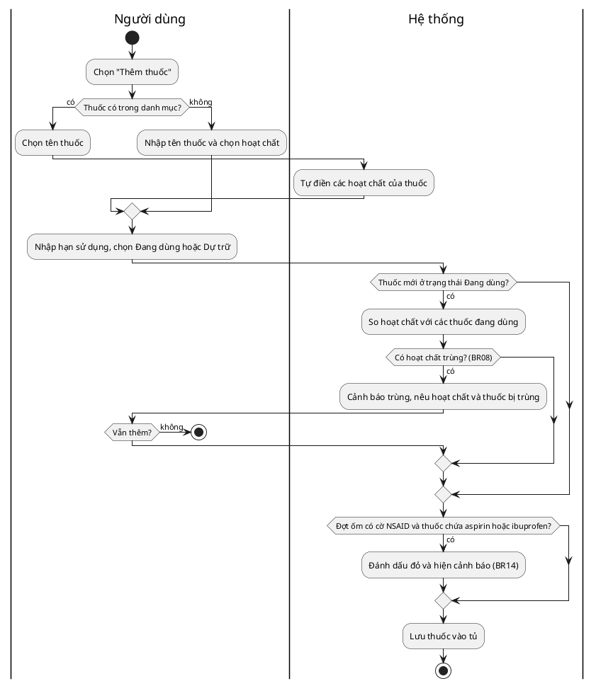

### 4.4 Ghi nhật ký (thay thế một phần sơ đồ 8.3 của v1.1)
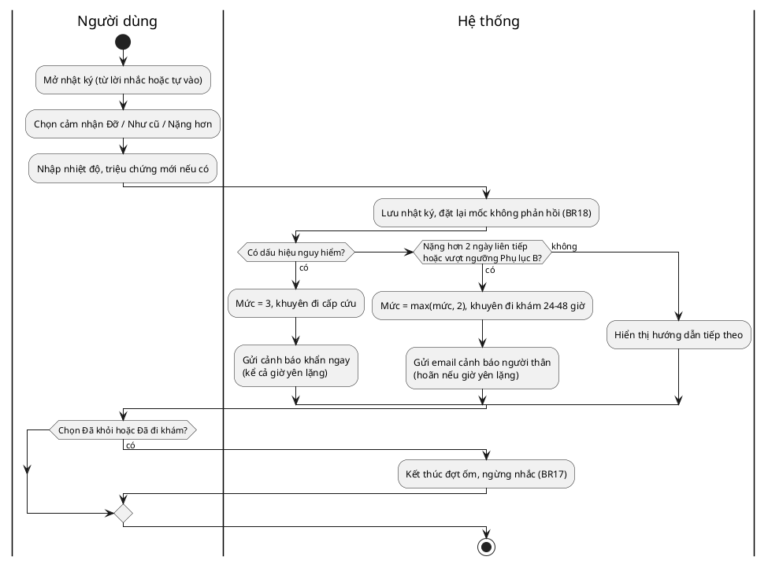

### 4.5 Bộ hẹn giờ quét định kỳ (thay thế phần còn lại của sơ đồ 8.3)
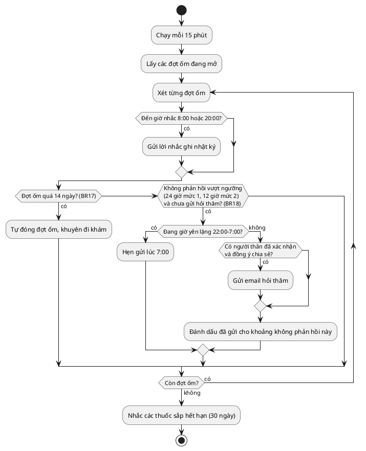

---

## 5. Sơ đồ tuần tự

### 5.1 SD1 – Sàng lọc triệu chứng
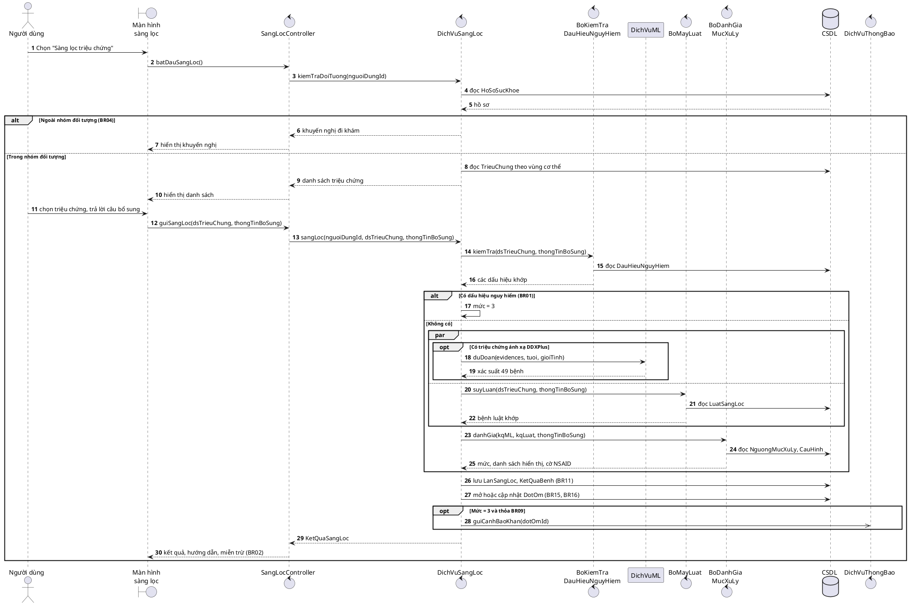

### 5.2 SD2 – Thêm thuốc và kiểm tra trùng hoạt chất
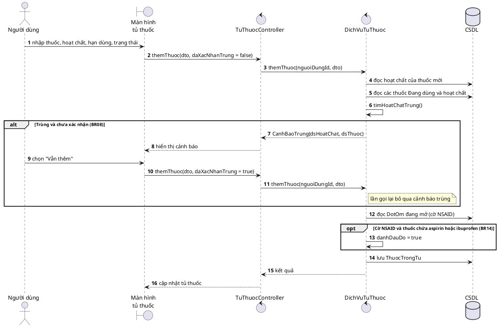

### 5.3 SD3 – Bộ hẹn giờ nhắc nhật ký và hỏi thăm người thân
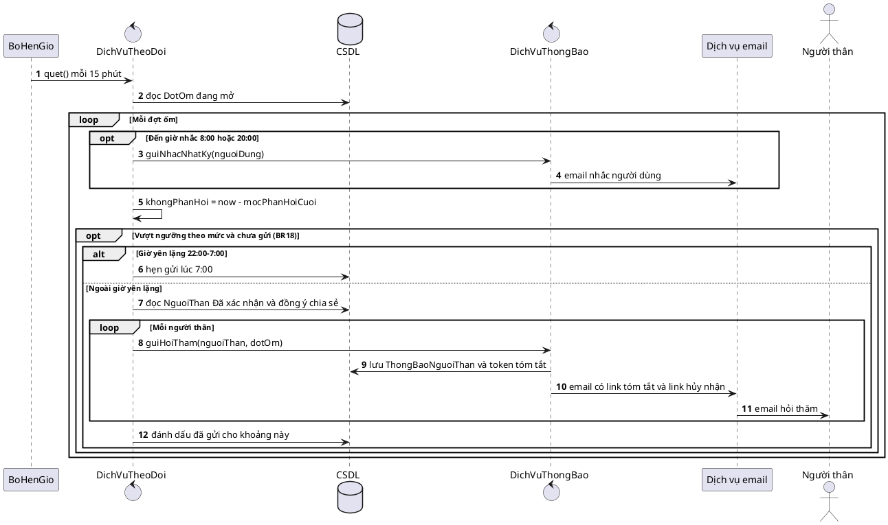

### 5.4 SD4 – Thêm người thân và xác nhận
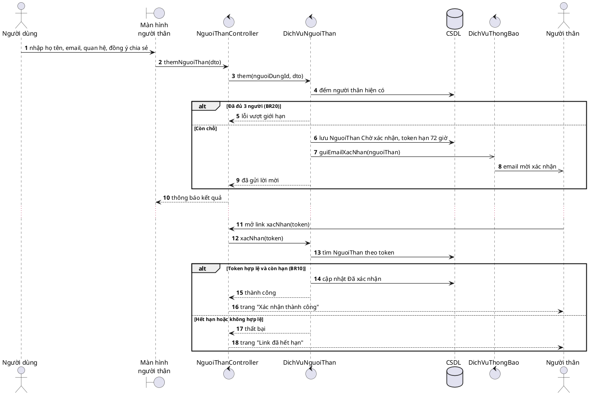

---

## 6. Sơ đồ lớp

### 6.1 Sơ đồ lớp thực thể (mô hình miền)
Sơ đồ này là cơ sở để thiết kế ERD ở Giai đoạn 3. Tên lớp viết không dấu để dùng được ngay trong code.

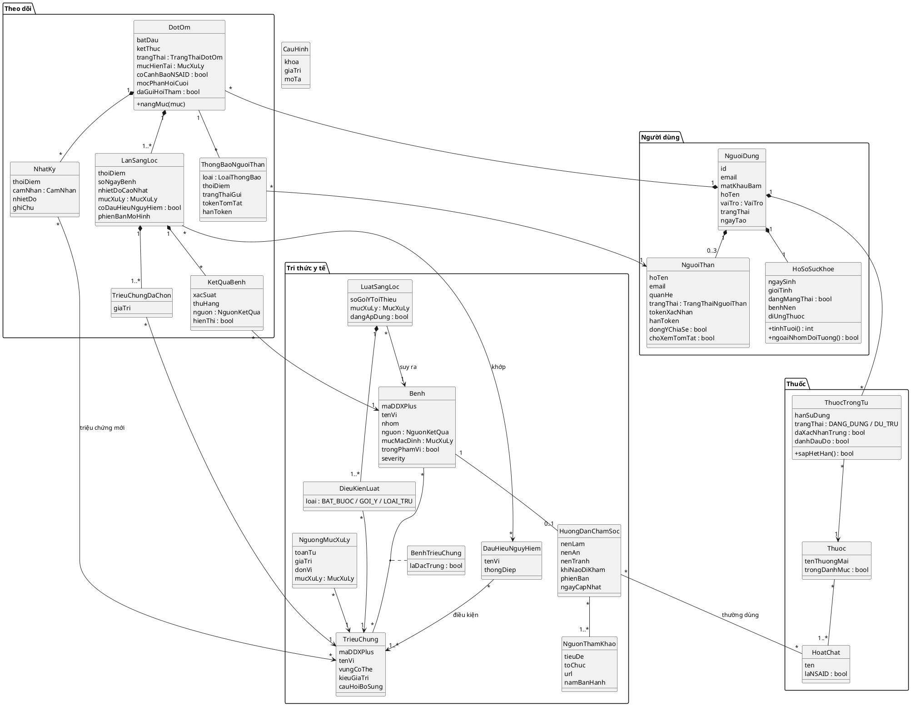

**Các kiểu liệt kê**
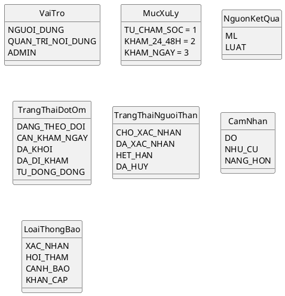

**Giải thích một số lựa chọn**
- **Bảng `Benh` lưu đủ 49 bệnh DDXPlus và 7 bệnh luật**, phân biệt bằng `trongPhamVi` và `nguon`. Nhờ vậy `KetQuaBenh` trỏ được tới cả bệnh nặng dùng làm lưới an toàn, phục vụ thống kê và đánh giá sau này.
- **`TrieuChung.maDDXPlus`** là cầu nối giữa danh sách tiếng Việt và mã evidence của DDXPlus (ví dụ `E_91`). Triệu chứng chỉ dùng cho luật (ví dụ đỏ mắt) thì để trống.
- **`NguongMucXuLy`** đưa Phụ lục B vào dữ liệu thay vì viết cứng trong code (NFR06).
- **`DieuKienLuat`** có 3 loại: bắt buộc / gợi ý / loại trừ. Ví dụ viêm kết mạc: *bắt buộc* đỏ mắt; *gợi ý* ghèn, ngứa mắt, chảy nước mắt; cần ≥ 1 gợi ý.
- **`LanSangLoc.phienBanMoHinh`** ghi lại kết quả do phiên bản mô hình nào tạo ra, để so sánh khi train lại.

### 6.2 Sơ đồ lớp phân tích cho UC03 (Boundary – Control – Entity)
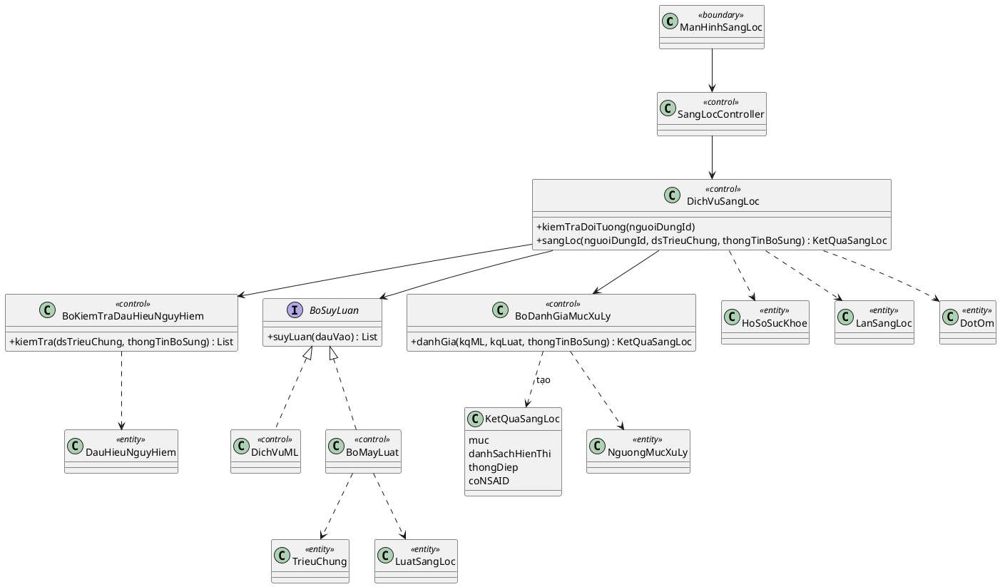

> `DichVuML` và `BoMayLuat` cùng thực hiện interface `BoSuyLuan`. Nhờ đó `DichVuSangLoc` không phụ thuộc vào việc kết quả đến từ ML hay từ luật. Đây là chỗ để áp dụng **Strategy pattern** ở Giai đoạn 3.

---

## 7. Sơ đồ trạng thái

### 7.1 Đợt ốm
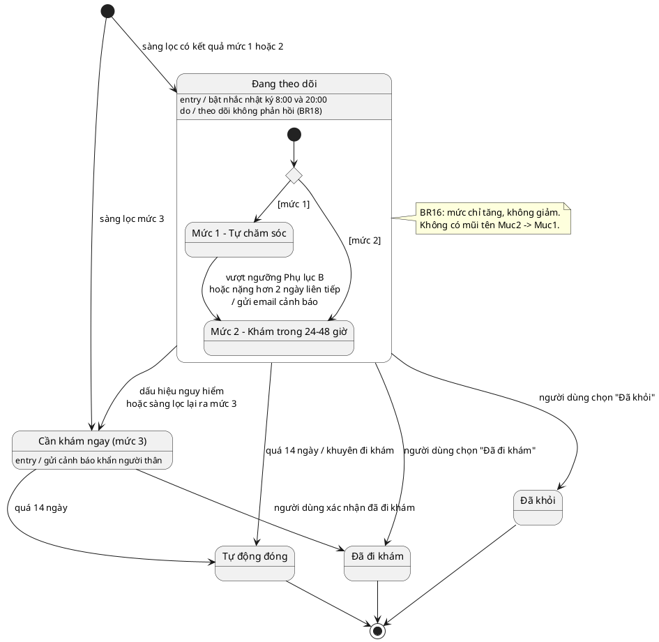

### 7.2 Liên kết người thân
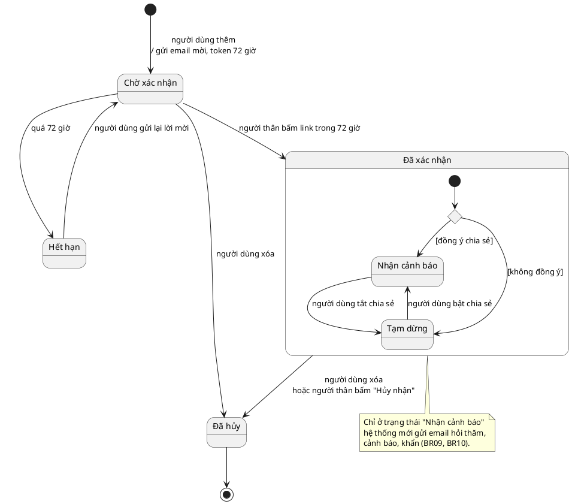

---

## 8. Ma trận truy vết

| Use case | Quy tắc nghiệp vụ | Hoạt động | Tuần tự | Trạng thái | Lớp chính |
|---|---|---|---|---|---|
| UC03 Sàng lọc | BR01–06, 11, 14–16, 19 | 4.1, 4.2 | SD1 | 7.1 | LanSangLoc, KetQuaBenh, DotOm |
| UC04 Dấu hiệu nguy hiểm | BR01 | 4.1, 4.4 | SD1 | 7.1 | DauHieuNguyHiem |
| UC05 Hướng dẫn | BR07, BR12 | – | – | – | HuongDanChamSoc, NguonThamKhao |
| UC06, UC07 Tủ thuốc | BR07, BR08, BR14 | 4.3 | SD2 | – | ThuocTrongTu, Thuoc, HoatChat |
| UC08 Nhật ký | BR01, 05, 16–18 | 4.4 | – | 7.1 | NhatKy, DotOm |
| UC09 Người thân | BR09, 10, 13, 20 | – | SD4 | 7.2 | NguoiThan |
| UC10 Cảnh báo | BR09, 10, 13, 18, 20 | 4.4, 4.5 | SD3 | 7.1, 7.2 | ThongBaoNguoiThan |
| UC12–14 Tri thức | BR07, BR12; NFR06 | – | – | – | Benh, TrieuChung, LuatSangLoc, NguongMucXuLy |
| UC16 Cấu hình | NFR06 | – | – | – | CauHinh |

---

## 9. Bàn giao cho Giai đoạn 3 (Thiết kế) và việc còn mở

**Cần chốt trước khi thiết kế**
- [ ] Đồng ý các điều chỉnh Đ1–Đ6 và BR15–BR20 → cập nhật nghiệp vụ v1.2.
- [ ] Đọc `release_conditions.json`: xem thang `severity` và chốt "bệnh rất nặng" là những bệnh nào.
- [ ] Đọc `release_evidences.json`: lập bảng ánh xạ triệu chứng tiếng Việt ↔ mã evidence. Bảng này quyết định danh sách `TrieuChung`.
- [ ] Thầy có bắt buộc đồ thị tri thức hoặc Neo4j không. Nếu có, các lớp `Benh`, `TrieuChung`, `BenhTrieuChung`, `DieuKienLuat` là phần chuyển sang đồ thị.

**Đầu vào cho Giai đoạn 3**
- Sơ đồ lớp 6.1 → ERD và SQL (PostgreSQL).
- Sơ đồ 6.2 → Strategy pattern cho `BoSuyLuan`. Các chỗ khác có thể cân nhắc: Chain of Responsibility cho chuỗi kiểm tra trong `BoDanhGiaMucXuLy`, Observer cho việc "mức tăng → gửi thông báo", State cho `DotOm`.
- SD1 → cách gọi mô hình ML: nạp trực tiếp trong backend, hay chạy một service Python riêng. Cần đảm bảo NFR03 (≤ 2 giây) và ngoại lệ E2.
