# THIẾT KẾ HỆ THỐNG: CƠ SỞ DỮ LIỆU, KIẾN TRÚC VÀ DESIGN PATTERN

**Đề tài:** Nền tảng hỗ trợ tự chăm sóc sức khỏe tại nhà cho người sống một mình: sàng lọc triệu chứng, hướng dẫn chăm sóc và cảnh báo người thân, tích hợp Học máy

**Đầu vào:** Phân tích nghiệp vụ v1.1 và Phân tích hệ thống + UML v1.0. Thiết kế này giả định các điều chỉnh Đ1–Đ6 và BR15–BR20 được chấp nhận.

---

## 0. Quyết định công nghệ

| Thành phần | Chọn | Lý do |
|---|---|---|
| Backend | **Spring Boot 3 (Java 21)**, modular monolith | Cùng kiến trúc đã làm ở đồ án Hotel Booking; OOP rõ ràng, dễ trình bày design pattern |
| Dịch vụ ML | **Python FastAPI**, service riêng | Mô hình train bằng Python trên DDXPlus. Tách riêng để backend không phụ thuộc thư viện ML và có thể train lại, thay mô hình mà không build lại backend |
| Frontend | **React + Vite** (SPA) | Gọi REST API, triển khai tĩnh qua Nginx |
| CSDL | **PostgreSQL 16** | Ràng buộc mạnh (partial unique index, CHECK, trigger) để giữ quy tắc nghiệp vụ ngay ở tầng dữ liệu |
| Migration | Flyway (`V<timestamp>__<mo_ta>.sql`) | Quản lý phiên bản schema |
| Email | SMTP; khi demo dùng **Mailpit** | Mailpit bắt mọi email và có giao diện web, nên demo luồng người thân được mà không cần email thật |
| Đóng gói | Docker Compose | Một lệnh chạy đủ 5 container khi demo |

---

## 1. Kiến trúc tổng thể

### 1.1 Sơ đồ triển khai
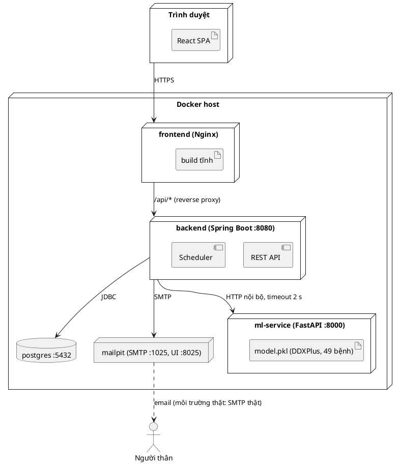

- Chỉ **frontend** mở ra ngoài. `ml-service` và `postgres` chỉ nằm trong mạng nội bộ của Docker.
- **ML không kết nối CSDL.** Mọi tri thức (ánh xạ triệu chứng, ngưỡng, luật) nằm ở backend. ML chỉ nhận danh sách mã evidence và trả xác suất. Nhờ vậy service ML không có trạng thái và dễ thay mô hình.

### 1.2 Kiến trúc backend: modular monolith theo tầng
Dùng lại cấu trúc của đồ án Hotel Booking: mỗi module có 4 tầng, và các module không gọi HTTP lẫn nhau.

```
com.team.health
├── shared        // ApiResponse, ProblemDetailFactory, Clock, sự kiện miền chung
├── identity      // UC01, UC15 – tài khoản, JWT, phân quyền
├── profile       // UC02 – hồ sơ sức khỏe
├── knowledge     // UC12–14 – bệnh, triệu chứng, red flag, luật, ngưỡng, hướng dẫn, thuốc
├── screening     // UC03–05 – sàng lọc, suy luận, mức xử lý
├── cabinet       // UC06–07 – tủ thuốc
├── monitoring    // UC08, UC10, UC11 – đợt ốm, nhật ký, scheduler
├── caregiver     // UC09 – người thân, xác nhận, hủy nhận, trang tóm tắt
├── notification  // outbox, mẫu email, gửi SMTP
└── admin         // UC16–17 – cấu hình, thống kê
```

Mỗi module:
```
<module>/
├── api            // controller, dto.request, dto.response
├── application    // command, result, usecase (interface), usecase.impl, port
├── domain         // model, service, repository (interface), exception
└── infrastructure // config, persistence (JPA entity, adapter, mapper), integration
```

**Quy tắc phụ thuộc**
- `domain` là Java thuần: không Spring, không JPA.
- `application` chỉ biết `domain` và các **port** (interface) của chính nó.
- Module A chỉ dùng module B qua **interface công khai** của B (ví dụ `screening` gọi `KnowledgeQuery` của `knowledge`), không import entity hay repository của B.
- Luồng xử lý: Request → Command → UseCase → Result → Response.

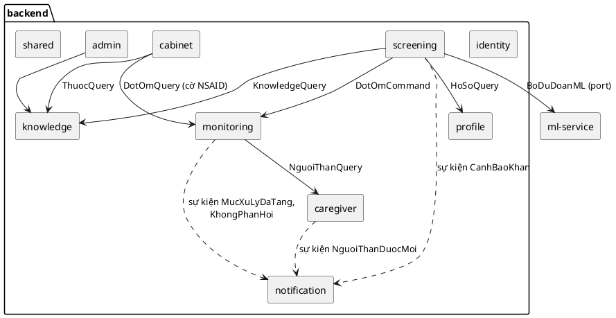

> Mũi tên liền là gọi đồng bộ qua interface. Mũi tên đứt là **sự kiện** (Observer, mục 4.5). Nhờ vậy `notification` không bị các module nghiệp vụ phụ thuộc trực tiếp, và nghiệp vụ không phải chờ gửi email.

---

## 2. Thiết kế dịch vụ ML

### 2.1 Hợp đồng API
`POST /predict`
```json
{
  "evidences": ["E_91", "E_53", "E_55_@_V_89"],
  "age": 27,
  "sex": "F"
}
```
Phản hồi: đủ 49 bệnh, sắp giảm dần theo xác suất.
```json
{
  "model_version": "ddx-2026.12.1",
  "probabilities": [
    {"code": "URTI", "p": 0.6123},
    {"code": "Influenza", "p": 0.2011}
  ]
}
```
`GET /health`: dùng cho healthcheck của Docker. `GET /model-info`: phiên bản, ngày train, các độ đo top-1/top-3 trên tập test.

### 2.2 Phân chia trách nhiệm
| Việc | Nằm ở đâu | Lý do |
|---|---|---|
| Tiếng Việt → mã evidence (`E_xx`, `E_xx_@_V_yy`) | Backend, đọc từ `trieu_chung.ma_ddxplus` và `lua_chon_trieu_chung.ma_ddxplus` | Quản trị nội dung sửa ánh xạ qua UC12 mà không phải deploy lại ML |
| Mã evidence → vector đặc trưng | ML service | Cách mã hóa gắn chặt với mô hình đã train |
| Xác suất → mức xử lý, danh sách hiển thị | Backend (`BoDanhGiaMucXuLy`) | Ngưỡng là cấu hình nghiệp vụ (NFR06), không phải tham số mô hình |

Evidence lạ (không có trong bộ evidence của mô hình) thì bị bỏ qua và ghi vào trường `ignored` của phản hồi. Không trả lỗi, để tránh làm hỏng cả lần sàng lọc.

### 2.3 Lỗi và quá thời gian (ngoại lệ E2)
- Backend gọi ML với **timeout 2 giây** (lấy từ `cau_hinh.sang_loc.ml_timeout_ms`).
- Lỗi mạng, HTTP 5xx hoặc quá thời gian → adapter trả về `KetQuaSuyLuan.khongCo(LOI | QUA_THOI_GIAN)`, **không ném exception** lên trên.
- Luồng sàng lọc vẫn chạy luật và ngưỡng Phụ lục B. Quy tắc "danh sách rỗng → mức ≥ 2" bảo đảm lỗi kỹ thuật không bao giờ cho ra kết quả "tự chăm sóc".
- `lan_sang_loc.ml_trang_thai` và `ml_thoi_gian_ms` được lưu lại để thống kê độ ổn định.

---

## 3. Thiết kế cơ sở dữ liệu

### 3.1 Nguyên tắc
- Khóa chính là **UUID**. Thời điểm dùng `timestamptz` (lưu UTC). Ngày nghiệp vụ (ngày sinh, hạn dùng) dùng `date`.
- Giờ nhắc và giờ yên lặng được tính theo múi giờ `Asia/Ho_Chi_Minh` lấy từ `cau_hinh`, **không** dựa vào giờ của máy chủ.
- Kiểu liệt kê lưu bằng `varchar` + `CHECK`, không dùng `ENUM` của PostgreSQL: dễ map với JPA `@Enumerated(STRING)`, và thêm giá trị chỉ cần sửa CHECK.
- Token (xác nhận, hủy nhận, tóm tắt, đặt lại mật khẩu) **chỉ lưu SHA-256**. Lộ CSDL cũng không dùng lại được link.
- Quy tắc nghiệp vụ quan trọng được chặn **hai lớp**: service kiểm tra trước để trả lỗi tiếng Việt dễ hiểu, CSDL chặn cuối để an toàn khi có request đồng thời.

### 3.2 Sơ đồ ERD
Tách thành 3 sơ đồ cho dễ đọc. Bảng ở sơ đồ khác được ghi kèm `(ref)`.

**ERD-1: Người dùng, theo dõi, thông báo**
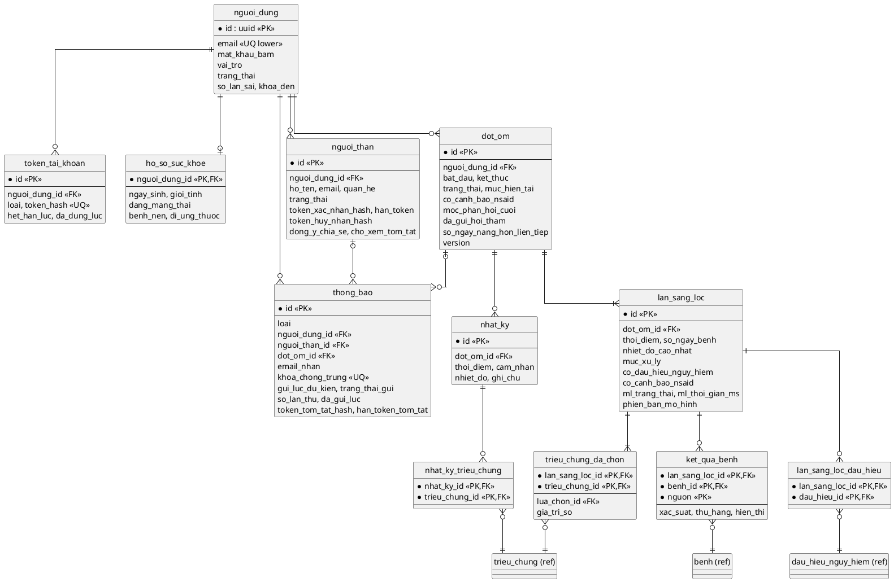

**ERD-2: Tri thức y tế**
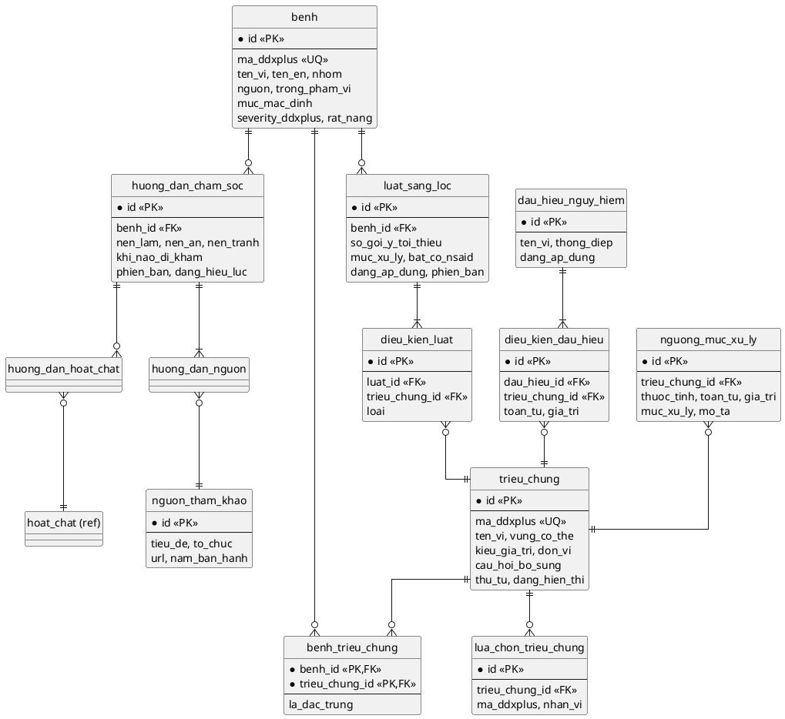

**ERD-3: Thuốc và cấu hình**
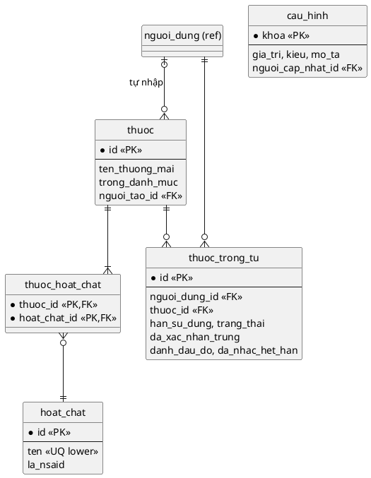

### 3.3 Thay đổi so với sơ đồ lớp 6.1
| Thay đổi | Lý do |
|---|---|
| `ThongBaoNguoiThan` → bảng chung **`thong_bao`** (thêm loại `NHAC_NHAT_KY`, `NHAC_HET_HAN`, `TAI_KHOAN`) | Mọi email dùng chung một cơ chế outbox: hoãn giờ yên lặng, thử lại khi lỗi, chống gửi trùng (mục 4.8) |
| Thêm `khoa_chong_trung` (UNIQUE) | Bảo đảm BR18 "mỗi khoảng không phản hồi chỉ 1 email", kể cả khi scheduler chạy lại hoặc chạy chồng |
| Thêm `lua_chon_trieu_chung` | DDXPlus có evidence dạng lựa chọn (mã `E_xx_@_V_yy`), một cột `maDDXPlus` không đủ |
| Thêm `dieu_kien_dau_hieu` | Một red flag có thể cần nhiều điều kiện cùng lúc, hoặc điều kiện theo giá trị |
| Thêm `token_tai_khoan` | Phục vụ UC01 (xác thực email, quên mật khẩu) |
| `dot_om.so_ngay_nang_hon_lien_tiep` | Xét quy tắc "nặng hơn 2 ngày liên tiếp" mà không phải quét lại toàn bộ nhật ký |
| `dot_om.version` | Khóa lạc quan: người dùng ghi nhật ký đúng lúc scheduler đang cập nhật đợt ốm |
| `lan_sang_loc.dot_om_id` NOT NULL | Ca ngoài nhóm đối tượng (UC03-A1) không được lưu, nên lần sàng lọc nào được lưu cũng thuộc một đợt ốm |
| `lan_sang_loc.ml_trang_thai`, `ml_thoi_gian_ms` | Thống kê lỗi ML (E2) và kiểm tra NFR03 |
| `benh.rat_nang` tách khỏi `severity_ddxplus` | Thang severity chưa chốt. Quản trị nội dung đánh dấu bệnh nào là "rất nặng", nên không phải sửa code khi đổi ngưỡng |
| `huong_dan_cham_soc` giữ nhiều phiên bản | UC13 yêu cầu lưu phiên bản; chỉ 1 bản `dang_hieu_luc` cho mỗi bệnh |

### 3.4 Quy tắc nghiệp vụ được chặn ở CSDL
Tất cả các dòng dưới đây đã **chạy thử trên PostgreSQL 16**: thao tác vi phạm đều bị từ chối, thao tác hợp lệ đều đi qua.

| Quy tắc | Cách chặn |
|---|---|
| BR15 – tối đa 1 đợt ốm mở | `UNIQUE INDEX uq_dot_om_dang_mo (nguoi_dung_id) WHERE trang_thai IN ('DANG_THEO_DOI','CAN_KHAM_NGAY')` |
| BR17 – đợt đã đóng phải có thời điểm kết thúc | `CHECK ((trang_thai đang mở) = (ket_thuc IS NULL))` |
| Trạng thái `CAN_KHAM_NGAY` ⇔ mức 3 | `CHECK (trang_thai <> 'CAN_KHAM_NGAY' OR muc_hien_tai = 3)` |
| BR20 – tối đa 3 người thân | Trigger `trg_gioi_han_nguoi_than`, khóa dòng `nguoi_dung` để tránh 2 request cùng thêm người thứ 3; chặn cả trường hợp khôi phục người đã hủy |
| Không thêm trùng email người thân | `UNIQUE (nguoi_dung_id, lower(email)) WHERE trang_thai <> 'DA_HUY'` |
| BR13 – email hỏi thăm, cảnh báo, khẩn phải có người nhận là người thân | `CHECK` trên `thong_bao` |
| BR18 – không gửi trùng | `UNIQUE (khoa_chong_trung)` |
| BR07 – không lưu liều dùng | Bảng thuốc **không có** cột liều |
| BR19 – không hiển thị tên bệnh nặng | `CHECK (NOT (rat_nang AND trong_pham_vi))`; bệnh rất nặng luôn lưu với `hien_thi = false` |
| Mang thai chỉ với giới tính nữ | `CHECK (NOT dang_mang_thai OR gioi_tinh = 'F')` |
| Nhiệt độ hợp lệ | `CHECK (nhiet_do BETWEEN 34 AND 43)` |

> BR16 (mức chỉ tăng) được giữ ở **tầng domain** (`DotOm.nangMuc`, mục 4.4), không giữ ở CSDL. Lý do: cần trả thông điệp nghiệp vụ, và trigger "so sánh giá trị cũ/mới" sẽ làm unit test khó hơn.

### 3.5 Chỉ mục phục vụ truy vấn chính
| Truy vấn | Chỉ mục |
|---|---|
| Scheduler lấy các đợt ốm đang mở (15 phút/lần) | `ix_dot_om_quet` (partial, chỉ đợt mở) |
| Job gửi outbox lấy email đến hạn | `ix_thong_bao_cho_gui` (partial `trang_thai_gui = 'CHO'`) |
| Kiểm tra trùng hoạt chất | `ix_tu_thuoc_dang_dung` (partial `DANG_DUNG`) |
| Nhắc thuốc sắp hết hạn | `ix_tu_thuoc_han` |
| Lịch sử UC11 | `ix_lan_sang_loc_dot_om`, `ix_nhat_ky_dot_om` |
| Thống kê theo ngày UC17 | `ix_lan_sang_loc_thoi_diem` |

### 3.6 Dữ liệu khởi tạo
| Migration | Nội dung | Cách tạo |
|---|---|---|
| `V1__khoi_tao_csdl.sql` | Toàn bộ bảng + `cau_hinh` mặc định | Phụ lục A |
| `V2__benh_ddxplus.sql` | 49 bệnh DDXPlus + 7 bệnh luật | Script Python đọc `release_conditions.json` sinh ra SQL |
| `V3__trieu_chung.sql` | Triệu chứng tiếng Việt + mã evidence + lựa chọn | Script đọc `release_evidences.json`, sau đó dịch tay nhãn tiếng Việt |
| `V4__luat_nguong_dau_hieu.sql` | Luật 7 bệnh, ngưỡng Phụ lục B, red flag | Viết tay theo nghiệp vụ v1.1 |
| `V5__thuoc_huong_dan.sql` | 15–20 hoạt chất, thuốc OTC, hướng dẫn 15 bệnh + nguồn | Viết tay |
| `R__tai_khoan_demo.sql` | Admin, quản trị nội dung, 2 người dùng demo | Chỉ chạy ở profile `demo` |

---

## 4. Design pattern

### 4.1 Tổng quan
| # | Pattern | Áp dụng ở đâu | Vấn đề giải quyết |
|---|---|---|---|
| 1 | **Strategy** | `BoSuyLuan` ← `SuyLuanML`, `SuyLuanLuat` | Dịch vụ sàng lọc không cần biết kết quả đến từ ML hay từ luật; thêm nguồn suy luận mới không phải sửa luồng chính |
| 2 | **Chain of Responsibility** | `BoDanhGiaMucXuLy` = chuỗi `QuyTacMucXuLy` | Sơ đồ 4.2 có nhiều bước theo **thứ tự quan trọng** (Đ2: lưới an toàn trước ngưỡng 0,50). Tách mỗi bước thành 1 lớp để test riêng và đổi thứ tự dễ |
| 3 | **State** | `DotOm` + `TrangThaiDotOm` | Hành vi khác nhau theo trạng thái (sơ đồ 7.1); chặn chuyển trạng thái sai và giảm mức (BR16) |
| 4 | **Observer** (sự kiện miền) | `MucXuLyDaTang`, `CanhBaoKhan`, `KhongPhanHoi` → module `notification` | Nghiệp vụ không phụ thuộc vào việc gửi email (Đ5) |
| 5 | **Adapter** | Port `BoDuDoanML` ← `HttpMlAdapter` | Che giấu HTTP/JSON của FastAPI; xử lý timeout và lỗi ở một chỗ (E2) |
| 6 | **Template Method** + **Factory Method** | `MauEmail` và các lớp con; `MauEmailFactory` | Mọi email có chung khung, và **bắt buộc** có link hủy nhận (BR20) và không có tên bệnh (BR13) |
| 7 | **Repository** | Interface ở `domain`, cài đặt JPA ở `infrastructure` | Domain không phụ thuộc JPA, test domain không cần CSDL |
| 8 | **Transactional Outbox** (kiến trúc) | Bảng `thong_bao` + job gửi | Không mất email khi SMTP lỗi; hoãn giờ yên lặng; chống trùng |

Các mục dưới mô tả từng pattern: **vấn đề → thiết kế → sơ đồ lớp → mã khung**.

### 4.2 Strategy: nguồn suy luận
**Vấn đề.** Theo Đ1, ML và luật chạy song song rồi gộp kết quả. Hai nguồn trả kiểu dữ liệu khác nhau (xác suất hay khớp luật), lại có thể lỗi theo cách khác nhau. Nếu `DichVuSangLoc` gọi trực tiếp từng nguồn thì mỗi khi thêm nguồn mới (ví dụ mô hình tiếng Việt về sau) đều phải sửa luồng chính.

**Thiết kế.** Hai nguồn cùng trả `KetQuaSuyLuan` gồm danh sách `KhaNangBenh(benhId, xacSuat|null, nguon)` và trạng thái. `DichVuSangLoc` nhận `List<BoSuyLuan>` qua constructor và chạy tất cả song song.

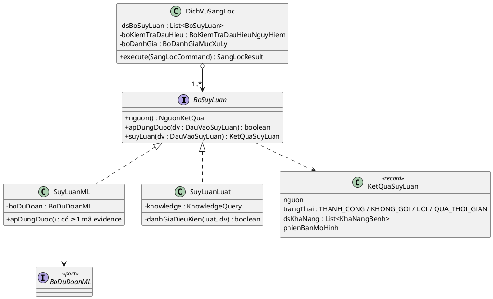

```java
// application/usecase/impl/SangLocService.java (rút gọn)
List<CompletableFuture<KetQuaSuyLuan>> tacVu = dsBoSuyLuan.stream()
    .filter(bo -> bo.apDungDuoc(dauVao))
    .map(bo -> CompletableFuture.supplyAsync(() -> bo.suyLuan(dauVao), executor)
        .completeOnTimeout(KetQuaSuyLuan.quaThoiGian(bo.nguon()), timeoutMs, MILLISECONDS)
        .exceptionally(ex -> KetQuaSuyLuan.loi(bo.nguon())))
    .toList();
List<KetQuaSuyLuan> ketQua = tacVu.stream().map(CompletableFuture::join).toList();
```
> `completeOnTimeout` và `exceptionally` bảo đảm một nguồn lỗi không làm hỏng cả lần sàng lọc. Đây là nửa thứ nhất của E2; nửa còn lại là quy tắc "danh sách rỗng" ở mục 4.3.

### 4.3 Chain of Responsibility: đánh giá mức xử lý
**Vấn đề.** Sơ đồ 4.2 có 7 bước và **thứ tự là quy tắc nghiệp vụ**. Nếu viết thành một hàm dài với nhiều `if` thì khó test từng ngưỡng, và dễ đảo thứ tự khi sửa (đúng lỗi Đ2 đã sửa ở bản phân tích).

**Thiết kế.** Mỗi bước là một `QuyTacMucXuLy`. Tất cả cùng đọc và ghi một `NguCanhDanhGia`. Đây là **biến thể pipeline** của Chain of Responsibility: mọi mắt xích đều chạy, không có mắt xích nào dừng chuỗi. Riêng red flag đã được xử lý **trước** chuỗi trong `DichVuSangLoc` (UC03-A2) vì nó cần dừng ngay.

| Thứ tự | Mắt xích | Hành động |
|---|---|---|
| 10 | `LuoiAnToan` | Có bệnh `rat_nang` với P ≥ 0,10 → mức 3, đánh dấu ẩn tên (BR19) |
| 20 | `NgoaiPhamVi` | Tổng P bệnh ngoài phạm vi ≥ 0,15 → mức ≥ 2 |
| 30 | `DoTinCayML` | Top-1 ≥ 0,50 và thuộc 8 bệnh ML → thêm các bệnh trong phạm vi thuộc top-3 |
| 40 | `BenhLuat` | Thêm bệnh luật khớp; mức = max(mức, mức mặc định); bật cờ NSAID nếu luật có `bat_co_nsaid` |
| 50 | `NguongPhuLucB` | Áp các dòng `nguong_muc_xu_ly` |
| 60 | `CoNSAID` | Sốt từ ngày thứ 3 → bật cờ NSAID (BR14) |
| 99 | `DanhSachRong` | Không có bệnh nào hiển thị → mức ≥ 2, thông điệp "chưa đủ thông tin" |

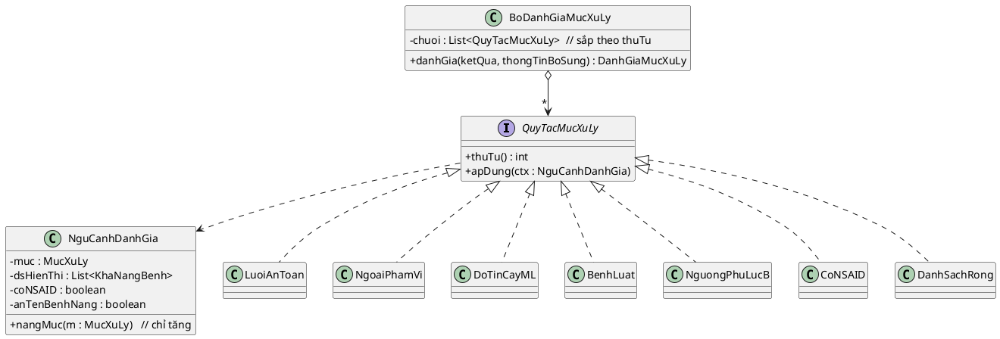

```java
public final class BoDanhGiaMucXuLy {
    private final List<QuyTacMucXuLy> chuoi;

    public BoDanhGiaMucXuLy(List<QuyTacMucXuLy> dsQuyTac) {
        this.chuoi = dsQuyTac.stream()
            .sorted(Comparator.comparingInt(QuyTacMucXuLy::thuTu)).toList();
    }

    public DanhGiaMucXuLy danhGia(List<KetQuaSuyLuan> ketQua, ThongTinBoSung tt, NguongCauHinh ng) {
        var ctx = new NguCanhDanhGia(ketQua, tt, ng);   // mức khởi đầu = TU_CHAM_SOC
        chuoi.forEach(q -> q.apDung(ctx));
        return ctx.ketLuan();
    }
}
```
**Lợi ích khi test:** mỗi mắt xích có một lớp test riêng (ví dụ `LuoiAnToanTests.shouldRaiseToLevel3WhenSevereDiseaseAtLeast10Percent`). Thêm một test tích hợp khẳng định thứ tự: một ca top-1 = 0,40 nhưng viêm phổi = 0,20 phải ra mức 3.

### 4.4 State: vòng đời đợt ốm
**Vấn đề.** Theo sơ đồ 7.1, cùng một thao tác lại có ý nghĩa khác nhau tùy trạng thái. "Nâng mức 3" khi đang theo dõi thì chuyển sang `CAN_KHAM_NGAY`; khi đợt đã đóng thì phải bị từ chối. "Đã khỏi" không hợp lệ khi đang `CAN_KHAM_NGAY` (chỉ được "Đã đi khám").

**Thiết kế.** Domain dùng enum mà mỗi hằng số tự cài đặt hành vi của nó. Đây là cách viết State pattern gọn trong Java, vì số trạng thái ít và cố định. `DotOm` ủy quyền cho trạng thái hiện tại.

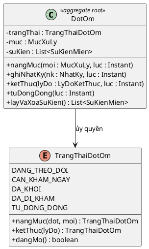

```java
public enum TrangThaiDotOm {
    DANG_THEO_DOI {
        TrangThaiDotOm nangMuc(MucXuLy moi) { return moi == MucXuLy.KHAM_NGAY ? CAN_KHAM_NGAY : this; }
        TrangThaiDotOm ketThuc(LyDoKetThuc ld) { return ld == LyDoKetThuc.DA_KHOI_BENH ? DA_KHOI : DA_DI_KHAM; }
    },
    CAN_KHAM_NGAY {
        TrangThaiDotOm nangMuc(MucXuLy moi) { return this; }          // đã ở mức cao nhất
        TrangThaiDotOm ketThuc(LyDoKetThuc ld) {
            if (ld != LyDoKetThuc.DA_DI_KHAM) throw new DotOmException(CHUA_DI_KHAM_KHI_MUC_3);
            return DA_DI_KHAM;
        }
    },
    DA_KHOI, DA_DI_KHAM, TU_DONG_DONG;                                 // trạng thái cuối

    TrangThaiDotOm nangMuc(MucXuLy moi) { throw new DotOmException(DOT_OM_DA_DONG); }
    TrangThaiDotOm ketThuc(LyDoKetThuc ld) { throw new DotOmException(DOT_OM_DA_DONG); }
}

// Trong DotOm
public void nangMuc(MucXuLy moi, Instant luc) {
    if (moi.compareTo(muc) <= 0) return;                                // BR16: không giảm
    var cu = muc;
    trangThai = trangThai.nangMuc(moi);
    muc = moi;
    suKien.add(new MucXuLyDaTang(id, nguoiDungId, cu, moi, luc));      // → Observer
}
```
> Mọi chuyển trạng thái chỉ đi qua `DotOm`. Đây là cài đặt trực tiếp của sơ đồ 7.1, và mỗi mũi tên trong sơ đồ tương ứng với một test case.

### 4.5 Observer: sự kiện miền và thông báo
**Vấn đề.** "Mức tăng → gửi email người thân" (Đ5) được kích hoạt từ 3 nơi: sàng lọc (UC03), nhật ký (UC08) và scheduler. Nếu cả 3 gọi thẳng dịch vụ gửi email thì nghiệp vụ phụ thuộc vào SMTP, và mỗi nơi phải tự lặp lại logic BR09/BR10 (người thân đã xác nhận, đồng ý chia sẻ).

**Thiết kế.**
1. `DotOm` **ghi nhận** sự kiện (`MucXuLyDaTang`, `KhongPhanHoi`, `CanhBaoKhan`). Domain không biết ai sẽ nghe.
2. Sau khi lưu, use case đẩy sự kiện qua port `SuKienPublisher`. Adapter dùng `ApplicationEventPublisher` của Spring.
3. Module `notification` có các listener chạy **trong cùng transaction** (`@TransactionalEventListener(phase = BEFORE_COMMIT)`). Listener lọc người thân theo BR09/BR10, tính giờ gửi (giờ yên lặng) và ghi dòng vào `thong_bao`. Listener **không** gửi SMTP.
4. Nếu transaction rollback thì không có email nào được tạo. Nếu commit thành công thì email chắc chắn nằm trong outbox.

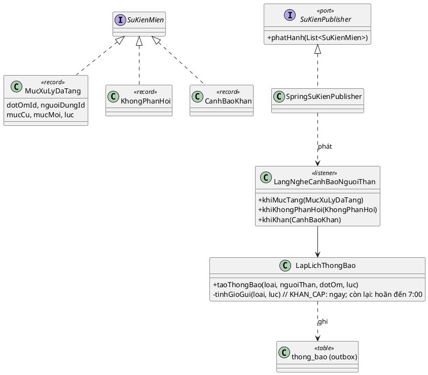

### 4.6 Adapter: gọi dịch vụ ML
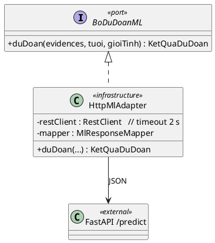
- `HttpMlAdapter` chuyển `PredictResponse` (tên trường tiếng Anh, mã bệnh DDXPlus) thành `KetQuaDuDoan` (mã → `benhId` nội bộ).
- Khi test, thay bằng `BoDuDoanMLGia` trả xác suất cố định. Nhờ vậy test được cả chuỗi mức xử lý mà không cần chạy Python.

### 4.7 Template Method + Factory Method: mẫu email
**Vấn đề.** Có 7 loại email. Hai ràng buộc **bắt buộc với mọi email gửi người thân**: có link hủy nhận (BR20), và không chứa tên bệnh hay triệu chứng (BR13). Nếu mỗi loại tự dựng nội dung thì dễ có loại quên link hủy.

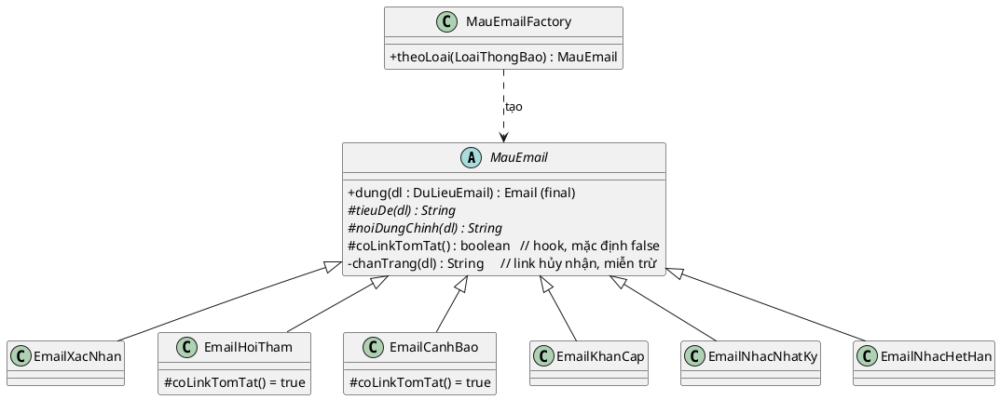

```java
public abstract class MauEmail {
    public final Email dung(DuLieuEmail dl) {           // final: lớp con không bỏ được chân trang
        var than = new StringBuilder()
            .append(loiChao(dl))
            .append(noiDungChinh(dl));
        if (coLinkTomTat() && dl.choXemTomTat()) than.append(linkTomTat(dl));
        than.append(chanTrang(dl));                     // BR20: luôn có link hủy nhận
        return new Email(dl.emailNhan(), tieuDe(dl), than.toString());
    }
    protected abstract String tieuDe(DuLieuEmail dl);
    protected abstract String noiDungChinh(DuLieuEmail dl);
    protected boolean coLinkTomTat() { return false; }
}
```
> `DuLieuEmail` **không có** trường tên bệnh hay triệu chứng. Vì vậy BR13 được bảo đảm bằng kiểu dữ liệu, không phụ thuộc vào việc người viết mẫu có nhớ quy tắc hay không.

### 4.8 Transactional Outbox và chống gửi trùng
**Luồng gửi**
1. Listener (mục 4.5) ghi `thong_bao` với `trang_thai_gui = 'CHO'` và `gui_luc_du_kien`.
2. Job `GuiThongBaoJob` chạy **mỗi 1 phút**: lấy các dòng đến hạn bằng `SELECT ... FOR UPDATE SKIP LOCKED LIMIT 50`, dựng email qua `MauEmailFactory` rồi gửi SMTP.
3. Thành công → `DA_GUI`. Lỗi → `so_lan_thu + 1`, lùi `gui_luc_du_kien` (1, 5, rồi 15 phút). Quá 5 lần → `LOI` và ghi log.
4. Riêng `KHAN_CAP`: sau khi commit, gọi gửi ngay một lần (`afterCommit`), không chờ đến lượt quét. Nếu lỗi thì job phút kế tiếp gửi lại.
5. Trước khi gửi, kiểm tra lại người thân còn `DA_XAC_NHAN` và `dong_y_chia_se`. Nếu không → `HUY` (người thân vừa bấm hủy nhận trong lúc email đang chờ 7:00).

**Khóa chống trùng** (`khoa_chong_trung`)
| Loại | Khóa | Ý nghĩa |
|---|---|---|
| HOI_THAM | `HOI_THAM:<dotOm>:<nguoiThan>:<mocPhanHoiCuoi>` | 1 email cho mỗi khoảng không phản hồi (BR18) |
| CANH_BAO | `CANH_BAO:<dotOm>:<nguoiThan>:<muc>` | Mỗi lần lên một mức chỉ báo 1 lần |
| KHAN_CAP | `KHAN_CAP:<dotOm>:<nguoiThan>` | Mỗi đợt ốm chỉ 1 email khẩn cho mỗi người thân |
| NHAC_NHAT_KY | `NHAC:<dotOm>:<ngày>:<giờ nhắc>` | Scheduler chạy lại không nhắc 2 lần |
| NHAC_HET_HAN | `HET_HAN:<thuocTrongTu>` | Nhắc 1 lần |

Insert dùng `ON CONFLICT (khoa_chong_trung) DO NOTHING`. Scheduler chạy chồng hay chạy lại sau sự cố đều an toàn.

---

## 5. Thiết kế tuần tự mức lớp: sàng lọc
SD1 ở bản phân tích dùng các thành phần logic. Sơ đồ dưới là bản ở mức thiết kế, cho thấy các pattern ở mục 4 phối hợp với nhau thế nào.

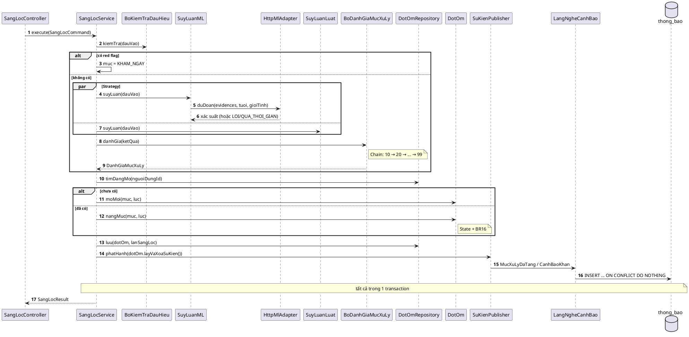

---

## 6. Thiết kế API REST
Tiền tố `/api/v1`. Thành công trả `ApiResponse{message, data}`; lỗi trả `ProblemDetail`.

| Module | Phương thức, đường dẫn | Vai trò | UC |
|---|---|---|---|
| identity | `POST /auth/register`, `/auth/login`, `/auth/refresh`, `/auth/forgot-password`, `/auth/reset-password`, `GET /auth/verify-email?token=` | Công khai | UC01 |
| profile | `GET`, `PUT /me/health-profile` | NGUOI_DUNG | UC02 |
| screening | `GET /symptoms?groupBy=bodyArea` | NGUOI_DUNG | UC03 |
| screening | `POST /screenings` | NGUOI_DUNG | UC03, UC04 |
| screening | `GET /diseases/{id}/care-guide`, `GET /diseases?inScope=true` | NGUOI_DUNG | UC05 |
| cabinet | `GET`, `POST /me/cabinet`; `PATCH`, `DELETE /me/cabinet/{id}` | NGUOI_DUNG | UC06, UC07 |
| cabinet | `GET /medicines?q=`, `GET /active-ingredients` | NGUOI_DUNG | UC06 |
| monitoring | `GET /me/episodes/current`; `POST /me/episodes/current/journal`; `POST /me/episodes/current/close` | NGUOI_DUNG | UC08 |
| monitoring | `GET /me/episodes`, `GET /me/episodes/{id}` | NGUOI_DUNG | UC11 |
| caregiver | `GET`, `POST /me/caregivers`; `PATCH`, `DELETE /me/caregivers/{id}`; `POST /me/caregivers/{id}/resend` | NGUOI_DUNG | UC09 |
| caregiver | `GET /public/caregivers/confirm?token=`, `GET /public/caregivers/unsubscribe?token=`, `GET /public/summaries/{token}` | Công khai (token) | UC09, UC10 |
| knowledge | `/admin/knowledge/diseases`, `/symptoms`, `/red-flags`, `/rules`, `/thresholds`, `/care-guides`, `/sources`, `/active-ingredients`, `/medicines` (CRUD) | QUAN_TRI_NOI_DUNG | UC12–14 |
| identity | `GET /admin/users`; `PATCH /admin/users/{id}/status`, `/role` | ADMIN | UC15 |
| admin | `GET`, `PUT /admin/settings/{key}` | ADMIN | UC16 |
| admin | `GET /admin/stats/screenings?from=&to=`, `/admin/stats/levels`, `/admin/stats/diseases` | ADMIN | UC17 |

**Một số quyết định**
- `POST /me/cabinet` có trường `confirmDuplicate`. Nếu trùng hoạt chất và trường này `false` thì trả **HTTP 409** kèm danh sách hoạt chất và thuốc bị trùng. Frontend hiện hộp thoại rồi gửi lại với `true` (SD2).
- Mọi đường dẫn `/me/...` lấy `nguoiDungId` từ JWT, không nhận qua tham số. Người dùng không thể đọc dữ liệu của người khác bằng cách đổi ID trên URL (BR13).
- Thống kê của Admin chỉ trả số đếm đã gộp. Thống kê theo bệnh chỉ hiện nhóm có ≥ 5 lượt, tránh suy ra được từng cá nhân.

---

## 7. Bảo mật và quyền riêng tư
| Yêu cầu | Thiết kế |
|---|---|
| NFR02 – mật khẩu | bcrypt (cost 10); khóa 15 phút sau 5 lần sai (`so_lan_sai`, `khoa_den`) |
| Xác thực | JWT access token 15 phút + refresh token 7 ngày (xoay vòng); quyền lấy từ principal |
| BR13 – Admin không xem dữ liệu sức khỏe | Vai trò ADMIN **không** có quyền gọi `/me/**` của người khác; module `admin` chỉ đọc qua truy vấn gộp (`COUNT`, `GROUP BY`) |
| Link công khai | Token ngẫu nhiên 32 byte, chỉ lưu SHA-256. Link xác nhận 72 giờ; link tóm tắt 72 giờ; link hủy nhận không hết hạn |
| Trang tóm tắt người thân | Chỉ có mức xử lý, cảm nhận gần nhất, thời điểm phản hồi cuối. Không có triệu chứng, không có tên bệnh |
| Log | Không ghi body request, token, mật khẩu hay triệu chứng; chỉ ghi ID |
| Chống dò email | `forgot-password` luôn trả cùng một thông điệp, dù email có tồn tại hay không |

---

## 8. Thiết kế bộ hẹn giờ
| Job | Chu kỳ | Việc |
|---|---|---|
| `QuetDotOmJob` | 15 phút | Nhắc nhật ký (8:00, 20:00); phát hiện không phản hồi → sự kiện `KhongPhanHoi`; tự đóng đợt quá 14 ngày |
| `GuiThongBaoJob` | 1 phút | Gửi outbox đến hạn (mục 4.8) |
| `NhacHetHanJob` | 7:05 hằng ngày | Thuốc còn ≤ 30 ngày hạn và chưa nhắc |
| `HetHanLoiMoiJob` | 1 giờ | `CHO_XAC_NHAN` quá 72 giờ → `HET_HAN` |

- **Giờ nhắc 8:00 với chu kỳ 15 phút.** Job không so sánh "bây giờ có đúng 8:00 không". Job hỏi: "đã qua 8:00 hôm nay chưa, và đã có dòng `NHAC:<dot>:<ngày>:08:00` chưa?". Nhờ khóa chống trùng, job chạy lúc 8:07 hay chạy lại lúc 8:22 đều chỉ nhắc 1 lần.
- **Không phản hồi:** `now − moc_phan_hoi_cuoi ≥ ngưỡng(muc)` và `da_gui_hoi_tham = false`. Ghi nhật ký thì đặt lại `moc_phan_hoi_cuoi` và `da_gui_hoi_tham = false`.
- Mọi job nhận `Clock` qua constructor. Test giả lập được 21:59, 22:01, 6:59 mà không phải chờ giờ thật.
- Demo chạy 1 instance backend nên chưa cần khóa phân tán. Nếu chạy nhiều instance thì thêm ShedLock (đã có `SKIP LOCKED` cho outbox).

---

## 9. Frontend (React)
| Khu vực | Màn hình |
|---|---|
| Công khai | Đăng nhập, đăng ký, quên mật khẩu; xác nhận người thân; hủy nhận; trang tóm tắt |
| Người dùng | Trang chủ (đợt ốm hiện tại + nút ghi nhật ký); Sàng lọc (3 bước: chọn triệu chứng theo vùng → câu hỏi bổ sung → kết quả); Hướng dẫn; Tủ thuốc; Người thân; Lịch sử; Hồ sơ |
| Quản trị nội dung | Bảng CRUD cho bệnh, triệu chứng, red flag, luật (form chọn điều kiện bắt buộc / gợi ý / loại trừ), ngưỡng, hướng dẫn, thuốc |
| Admin | Tài khoản, cấu hình, thống kê (biểu đồ) |

- Thư viện: React Router, TanStack Query (gọi API, cache), React Hook Form + Zod (kiểm tra form).
- Màn hình kết quả mức 3 dùng màu đỏ, nút "Gọi 115" (`tel:115`) đặt ở đầu trang, và **không** có nút "xem hướng dẫn tự chăm sóc".

---

## 10. Truy vết và việc còn mở

### 10.1 Truy vết thiết kế
| Yêu cầu | Bảng | Pattern / thành phần |
|---|---|---|
| UC03, Đ1 | `lan_sang_loc`, `ket_qua_benh` | Strategy (4.2) |
| Đ2, Phụ lục B, C | `nguong_muc_xu_ly`, `cau_hinh` | Chain (4.3) |
| E2, NFR03 | `lan_sang_loc.ml_trang_thai` | Adapter (4.6), `completeOnTimeout` |
| BR15–BR17, Đ3 | `dot_om` (partial unique, CHECK) | State (4.4) |
| Đ5, UC10 | `thong_bao` | Observer (4.5), Outbox (4.8) |
| BR13, BR20 | `nguoi_than`, `thong_bao` | Template Method (4.7), trigger giới hạn |
| BR18 | `thong_bao.khoa_chong_trung` | Outbox, `QuetDotOmJob` |
| NFR06 | `cau_hinh`, `nguong_muc_xu_ly`, `luat_sang_loc` | Đọc cấu hình lúc chạy, không viết cứng |

### 10.2 Việc còn mở
- [ ] Duyệt Đ1–Đ6, BR15–BR20 → nghiệp vụ v1.2 (thiết kế này đã giả định là được chấp nhận).
- [ ] Đọc `release_conditions.json` → điền `severity_ddxplus`, chọn các bệnh `rat_nang` → viết `V2`.
- [ ] Đọc `release_evidences.json` → bảng ánh xạ tiếng Việt → viết `V3`.
- [ ] Nếu thầy bắt buộc Neo4j: chỉ module `knowledge` đổi tầng `infrastructure`. Các interface `KnowledgeQuery` mà `screening` dùng giữ nguyên.
- [ ] Giai đoạn 4 (Học máy): chốt thuật toán và định dạng file mô hình, giữ đúng hợp đồng `/predict` ở mục 2.1.

---

## Phụ lục A. `V1__khoi_tao_csdl.sql`
Đã chạy thử trên PostgreSQL 16: tạo được 30 bảng; các ràng buộc ở mục 3.4 chặn đúng.

```sql
-- =====================================================================
-- V1__khoi_tao_csdl.sql  —  PostgreSQL 16
-- Quy ước: UUID cho ID, timestamptz (UTC) cho thời điểm, date cho ngày
-- nghiệp vụ, enum lưu varchar + CHECK (dễ map JPA, dễ thêm giá trị).
-- =====================================================================
CREATE EXTENSION IF NOT EXISTS pgcrypto;   -- gen_random_uuid()

-- ---------------------------------------------------------------------
-- 1. NGƯỜI DÙNG
-- ---------------------------------------------------------------------
CREATE TABLE nguoi_dung (
    id                 uuid PRIMARY KEY DEFAULT gen_random_uuid(),
    email              varchar(255) NOT NULL,
    mat_khau_bam       varchar(100) NOT NULL,                 -- bcrypt (NFR02)
    ho_ten             varchar(100) NOT NULL,
    vai_tro            varchar(20)  NOT NULL DEFAULT 'NGUOI_DUNG'
                       CHECK (vai_tro IN ('NGUOI_DUNG','QUAN_TRI_NOI_DUNG','ADMIN')),
    trang_thai         varchar(20)  NOT NULL DEFAULT 'CHUA_XAC_THUC'
                       CHECK (trang_thai IN ('CHUA_XAC_THUC','HOAT_DONG','BI_KHOA')),
    so_lan_sai         smallint     NOT NULL DEFAULT 0,
    khoa_den           timestamptz,                           -- khóa tạm sau 5 lần sai
    tao_luc            timestamptz  NOT NULL DEFAULT now(),
    cap_nhat_luc       timestamptz  NOT NULL DEFAULT now()
);
CREATE UNIQUE INDEX uq_nguoi_dung_email ON nguoi_dung (lower(email));

-- Token dùng một lần: xác thực email, đặt lại mật khẩu (chỉ lưu hash)
CREATE TABLE token_tai_khoan (
    id                 uuid PRIMARY KEY DEFAULT gen_random_uuid(),
    nguoi_dung_id      uuid NOT NULL REFERENCES nguoi_dung(id) ON DELETE CASCADE,
    loai               varchar(20) NOT NULL CHECK (loai IN ('XAC_THUC_EMAIL','DAT_LAI_MAT_KHAU')),
    token_hash         char(64)    NOT NULL UNIQUE,           -- SHA-256 hex
    het_han_luc        timestamptz NOT NULL,
    da_dung_luc        timestamptz
);

CREATE TABLE ho_so_suc_khoe (
    nguoi_dung_id      uuid PRIMARY KEY REFERENCES nguoi_dung(id) ON DELETE CASCADE,
    ngay_sinh          date        NOT NULL,
    gioi_tinh          char(1)     NOT NULL CHECK (gioi_tinh IN ('M','F')),   -- khớp DDXPlus
    dang_mang_thai     boolean     NOT NULL DEFAULT false,
    benh_nen           text,
    di_ung_thuoc       text,
    cap_nhat_luc       timestamptz NOT NULL DEFAULT now(),
    CHECK (NOT dang_mang_thai OR gioi_tinh = 'F')
);

CREATE TABLE nguoi_than (
    id                 uuid PRIMARY KEY DEFAULT gen_random_uuid(),
    nguoi_dung_id      uuid NOT NULL REFERENCES nguoi_dung(id) ON DELETE CASCADE,
    ho_ten             varchar(100) NOT NULL,
    email              varchar(255) NOT NULL,
    quan_he            varchar(50)  NOT NULL,
    trang_thai         varchar(20)  NOT NULL DEFAULT 'CHO_XAC_NHAN'
                       CHECK (trang_thai IN ('CHO_XAC_NHAN','DA_XAC_NHAN','HET_HAN','DA_HUY')),
    token_xac_nhan_hash char(64) UNIQUE,
    han_token          timestamptz,                           -- +72 giờ (BR20)
    token_huy_nhan_hash char(64) NOT NULL UNIQUE,             -- link hủy nhận cố định
    dong_y_chia_se     boolean NOT NULL DEFAULT true,
    cho_xem_tom_tat    boolean NOT NULL DEFAULT false,
    xac_nhan_luc       timestamptz,
    tao_luc            timestamptz NOT NULL DEFAULT now()
);
-- Một email không được thêm 2 lần cho cùng người dùng (trừ bản ghi đã hủy)
CREATE UNIQUE INDEX uq_nguoi_than_email ON nguoi_than (nguoi_dung_id, lower(email))
    WHERE trang_thai <> 'DA_HUY';

-- BR20: tối đa 3 người thân chưa hủy. Service kiểm tra trước (báo lỗi
-- thân thiện); trigger là lớp chặn cuối khi có 2 request đồng thời.
CREATE FUNCTION fn_gioi_han_nguoi_than() RETURNS trigger AS $$
BEGIN
    PERFORM 1 FROM nguoi_dung WHERE id = NEW.nguoi_dung_id FOR UPDATE;
    IF (SELECT count(*) FROM nguoi_than
         WHERE nguoi_dung_id = NEW.nguoi_dung_id AND trang_thai <> 'DA_HUY'
           AND id <> NEW.id) >= 3 THEN
        RAISE EXCEPTION 'BR20: toi da 3 nguoi than' USING ERRCODE = 'check_violation';
    END IF;
    RETURN NEW;
END $$ LANGUAGE plpgsql;
CREATE TRIGGER trg_gioi_han_nguoi_than
    BEFORE INSERT OR UPDATE OF trang_thai ON nguoi_than
    FOR EACH ROW WHEN (NEW.trang_thai <> 'DA_HUY')
    EXECUTE FUNCTION fn_gioi_han_nguoi_than();

-- ---------------------------------------------------------------------
-- 2. TRI THỨC Y TẾ
-- ---------------------------------------------------------------------
CREATE TABLE benh (
    id                 uuid PRIMARY KEY DEFAULT gen_random_uuid(),
    ma_ddxplus         varchar(100) UNIQUE,                   -- NULL với bệnh luật
    ten_vi             varchar(150) NOT NULL,
    ten_en             varchar(150),
    nhom               varchar(30)  NOT NULL CHECK (nhom IN ('HO_HAP','TIEU_HOA','KHAC')),
    nguon              varchar(10)  NOT NULL CHECK (nguon IN ('ML','LUAT')),
    trong_pham_vi      boolean      NOT NULL,                 -- 15 bệnh = true
    muc_mac_dinh       smallint     NOT NULL DEFAULT 1 CHECK (muc_mac_dinh BETWEEN 1 AND 3),
    severity_ddxplus   smallint,                              -- từ release_conditions.json
    rat_nang           boolean      NOT NULL DEFAULT false,   -- lưới an toàn: P ≥ 0,10 → mức 3
    CHECK (nguon = 'LUAT' OR ma_ddxplus IS NOT NULL),
    CHECK (NOT (rat_nang AND trong_pham_vi))
);

CREATE TABLE trieu_chung (
    id                 uuid PRIMARY KEY DEFAULT gen_random_uuid(),
    ma_ddxplus         varchar(50) UNIQUE,                    -- vd E_91; NULL nếu chỉ dùng cho luật
    ten_vi             varchar(200) NOT NULL,
    vung_co_the        varchar(30)  NOT NULL
                       CHECK (vung_co_the IN ('TOAN_THAN','DAU_MAT','TAI_MUI_HONG','NGUC_HO_HAP','BUNG_TIEU_HOA','DA','KHAC')),
    kieu_gia_tri       varchar(15)  NOT NULL DEFAULT 'CO_KHONG'
                       CHECK (kieu_gia_tri IN ('CO_KHONG','MOT_LUA_CHON','NHIEU_LUA_CHON','SO')),
    don_vi             varchar(20),                           -- °C, ngày ... khi kieu = SO
    cau_hoi_bo_sung    text,
    thu_tu             smallint NOT NULL DEFAULT 0,
    dang_hien_thi      boolean  NOT NULL DEFAULT true
);

-- Giá trị lựa chọn của triệu chứng dạng phân loại (vd vị trí đau → V_xx)
CREATE TABLE lua_chon_trieu_chung (
    id                 uuid PRIMARY KEY DEFAULT gen_random_uuid(),
    trieu_chung_id     uuid NOT NULL REFERENCES trieu_chung(id) ON DELETE CASCADE,
    ma_ddxplus         varchar(50),                           -- vd V_10
    nhan_vi            varchar(150) NOT NULL,
    thu_tu             smallint NOT NULL DEFAULT 0,
    UNIQUE (trieu_chung_id, ma_ddxplus)
);

CREATE TABLE benh_trieu_chung (
    benh_id            uuid NOT NULL REFERENCES benh(id) ON DELETE CASCADE,
    trieu_chung_id     uuid NOT NULL REFERENCES trieu_chung(id) ON DELETE CASCADE,
    la_dac_trung       boolean NOT NULL DEFAULT false,
    PRIMARY KEY (benh_id, trieu_chung_id)
);

CREATE TABLE dau_hieu_nguy_hiem (
    id                 uuid PRIMARY KEY DEFAULT gen_random_uuid(),
    ten_vi             varchar(200) NOT NULL,
    thong_diep         text NOT NULL,
    dang_ap_dung       boolean NOT NULL DEFAULT true
);
-- Một red flag khớp khi TẤT CẢ điều kiện của nó đúng
CREATE TABLE dieu_kien_dau_hieu (
    id                 uuid PRIMARY KEY DEFAULT gen_random_uuid(),
    dau_hieu_id        uuid NOT NULL REFERENCES dau_hieu_nguy_hiem(id) ON DELETE CASCADE,
    trieu_chung_id     uuid NOT NULL REFERENCES trieu_chung(id),
    toan_tu            varchar(5)  NOT NULL DEFAULT 'CO' CHECK (toan_tu IN ('CO','>=','>','<=','<','=')),
    gia_tri            numeric(6,2)
);

CREATE TABLE luat_sang_loc (
    id                 uuid PRIMARY KEY DEFAULT gen_random_uuid(),
    benh_id            uuid NOT NULL REFERENCES benh(id),
    so_goi_y_toi_thieu smallint NOT NULL DEFAULT 1 CHECK (so_goi_y_toi_thieu >= 0),
    muc_xu_ly          smallint NOT NULL CHECK (muc_xu_ly BETWEEN 1 AND 3),
    bat_co_nsaid       boolean  NOT NULL DEFAULT false,       -- sốt xuất huyết (BR14)
    dang_ap_dung       boolean  NOT NULL DEFAULT true,
    phien_ban          integer  NOT NULL DEFAULT 1,
    cap_nhat_luc       timestamptz NOT NULL DEFAULT now()
);
CREATE TABLE dieu_kien_luat (
    id                 uuid PRIMARY KEY DEFAULT gen_random_uuid(),
    luat_id            uuid NOT NULL REFERENCES luat_sang_loc(id) ON DELETE CASCADE,
    trieu_chung_id     uuid NOT NULL REFERENCES trieu_chung(id),
    loai               varchar(10) NOT NULL CHECK (loai IN ('BAT_BUOC','GOI_Y','LOAI_TRU')),
    UNIQUE (luat_id, trieu_chung_id)
);

-- Phụ lục B đưa vào dữ liệu (NFR06)
CREATE TABLE nguong_muc_xu_ly (
    id                 uuid PRIMARY KEY DEFAULT gen_random_uuid(),
    trieu_chung_id     uuid NOT NULL REFERENCES trieu_chung(id),
    thuoc_tinh         varchar(15) NOT NULL CHECK (thuoc_tinh IN ('SO_NGAY','GIA_TRI','CO_MAU','MAT_NUOC')),
    toan_tu            varchar(5)  NOT NULL CHECK (toan_tu IN ('>=','>','=')),
    gia_tri            numeric(6,2) NOT NULL,
    muc_xu_ly          smallint NOT NULL CHECK (muc_xu_ly BETWEEN 2 AND 3),
    mo_ta              varchar(255) NOT NULL,
    dang_ap_dung       boolean NOT NULL DEFAULT true
);

CREATE TABLE nguon_tham_khao (
    id                 uuid PRIMARY KEY DEFAULT gen_random_uuid(),
    tieu_de            varchar(300) NOT NULL,
    to_chuc            varchar(150) NOT NULL,
    url                varchar(500),
    nam_ban_hanh       smallint
);

CREATE TABLE huong_dan_cham_soc (
    id                 uuid PRIMARY KEY DEFAULT gen_random_uuid(),
    benh_id            uuid NOT NULL REFERENCES benh(id),
    nen_lam            text NOT NULL,
    nen_an             text NOT NULL,
    nen_tranh          text NOT NULL,
    khi_nao_di_kham    text NOT NULL,
    phien_ban          integer NOT NULL DEFAULT 1,
    dang_hieu_luc      boolean NOT NULL DEFAULT true,
    nguoi_cap_nhat_id  uuid REFERENCES nguoi_dung(id),
    cap_nhat_luc       timestamptz NOT NULL DEFAULT now(),
    UNIQUE (benh_id, phien_ban)
);
-- Mỗi bệnh chỉ 1 phiên bản hướng dẫn đang hiệu lực; bản cũ giữ lại làm lịch sử
CREATE UNIQUE INDEX uq_huong_dan_hieu_luc ON huong_dan_cham_soc (benh_id) WHERE dang_hieu_luc;

CREATE TABLE huong_dan_nguon (
    huong_dan_id       uuid NOT NULL REFERENCES huong_dan_cham_soc(id) ON DELETE CASCADE,
    nguon_id           uuid NOT NULL REFERENCES nguon_tham_khao(id),
    PRIMARY KEY (huong_dan_id, nguon_id)
);

-- ---------------------------------------------------------------------
-- 3. THUỐC  (BR07: không có cột liều dùng)
-- ---------------------------------------------------------------------
CREATE TABLE hoat_chat (
    id                 uuid PRIMARY KEY DEFAULT gen_random_uuid(),
    ten                varchar(100) NOT NULL,
    la_nsaid           boolean NOT NULL DEFAULT false
);
CREATE UNIQUE INDEX uq_hoat_chat_ten ON hoat_chat (lower(ten));

CREATE TABLE huong_dan_hoat_chat (
    huong_dan_id       uuid NOT NULL REFERENCES huong_dan_cham_soc(id) ON DELETE CASCADE,
    hoat_chat_id       uuid NOT NULL REFERENCES hoat_chat(id),
    PRIMARY KEY (huong_dan_id, hoat_chat_id)
);

CREATE TABLE thuoc (
    id                 uuid PRIMARY KEY DEFAULT gen_random_uuid(),
    ten_thuong_mai     varchar(150) NOT NULL,
    trong_danh_muc     boolean NOT NULL DEFAULT true,
    nguoi_tao_id       uuid REFERENCES nguoi_dung(id) ON DELETE CASCADE,  -- thuốc tự nhập (UC06-A1)
    CHECK (trong_danh_muc = (nguoi_tao_id IS NULL))
);

CREATE TABLE thuoc_hoat_chat (
    thuoc_id           uuid NOT NULL REFERENCES thuoc(id) ON DELETE CASCADE,
    hoat_chat_id       uuid NOT NULL REFERENCES hoat_chat(id),
    PRIMARY KEY (thuoc_id, hoat_chat_id)
);

CREATE TABLE thuoc_trong_tu (
    id                 uuid PRIMARY KEY DEFAULT gen_random_uuid(),
    nguoi_dung_id      uuid NOT NULL REFERENCES nguoi_dung(id) ON DELETE CASCADE,
    thuoc_id           uuid NOT NULL REFERENCES thuoc(id),
    han_su_dung        date NOT NULL,
    trang_thai         varchar(10) NOT NULL CHECK (trang_thai IN ('DANG_DUNG','DU_TRU')),
    da_xac_nhan_trung  boolean NOT NULL DEFAULT false,
    danh_dau_do        boolean NOT NULL DEFAULT false,
    da_nhac_het_han    boolean NOT NULL DEFAULT false,
    tao_luc            timestamptz NOT NULL DEFAULT now()
);
CREATE INDEX ix_tu_thuoc_dang_dung ON thuoc_trong_tu (nguoi_dung_id) WHERE trang_thai = 'DANG_DUNG';
CREATE INDEX ix_tu_thuoc_han ON thuoc_trong_tu (han_su_dung) WHERE NOT da_nhac_het_han;

-- ---------------------------------------------------------------------
-- 4. THEO DÕI
-- ---------------------------------------------------------------------
CREATE TABLE dot_om (
    id                 uuid PRIMARY KEY DEFAULT gen_random_uuid(),
    nguoi_dung_id      uuid NOT NULL REFERENCES nguoi_dung(id) ON DELETE CASCADE,
    bat_dau            timestamptz NOT NULL,
    ket_thuc           timestamptz,
    trang_thai         varchar(20) NOT NULL
                       CHECK (trang_thai IN ('DANG_THEO_DOI','CAN_KHAM_NGAY','DA_KHOI','DA_DI_KHAM','TU_DONG_DONG')),
    muc_hien_tai       smallint NOT NULL CHECK (muc_hien_tai BETWEEN 1 AND 3),
    co_canh_bao_nsaid  boolean NOT NULL DEFAULT false,
    moc_phan_hoi_cuoi  timestamptz NOT NULL,                  -- BR18
    da_gui_hoi_tham    boolean NOT NULL DEFAULT false,        -- 1 email / khoảng không phản hồi
    so_ngay_nang_hon_lien_tiep smallint NOT NULL DEFAULT 0,
    version            integer NOT NULL DEFAULT 0,            -- optimistic lock (JPA @Version)
    CHECK ((trang_thai IN ('DANG_THEO_DOI','CAN_KHAM_NGAY')) = (ket_thuc IS NULL)),
    CHECK (trang_thai <> 'CAN_KHAM_NGAY' OR muc_hien_tai = 3)
);
-- BR15: mỗi người dùng tối đa 1 đợt ốm đang mở
CREATE UNIQUE INDEX uq_dot_om_dang_mo ON dot_om (nguoi_dung_id)
    WHERE trang_thai IN ('DANG_THEO_DOI','CAN_KHAM_NGAY');
CREATE INDEX ix_dot_om_quet ON dot_om (moc_phan_hoi_cuoi)
    WHERE trang_thai IN ('DANG_THEO_DOI','CAN_KHAM_NGAY');

CREATE TABLE lan_sang_loc (
    id                 uuid PRIMARY KEY DEFAULT gen_random_uuid(),
    dot_om_id          uuid NOT NULL REFERENCES dot_om(id) ON DELETE CASCADE,
    thoi_diem          timestamptz NOT NULL DEFAULT now(),
    so_ngay_benh       smallint CHECK (so_ngay_benh >= 0),
    nhiet_do_cao_nhat  numeric(3,1) CHECK (nhiet_do_cao_nhat BETWEEN 34 AND 43),
    muc_xu_ly          smallint NOT NULL CHECK (muc_xu_ly BETWEEN 1 AND 3),
    co_dau_hieu_nguy_hiem boolean NOT NULL DEFAULT false,
    co_canh_bao_nsaid  boolean NOT NULL DEFAULT false,
    ml_trang_thai      varchar(15) NOT NULL
                       CHECK (ml_trang_thai IN ('THANH_CONG','KHONG_GOI','LOI','QUA_THOI_GIAN')),
    ml_thoi_gian_ms    integer,
    phien_ban_mo_hinh  varchar(30)
);
CREATE INDEX ix_lan_sang_loc_dot_om ON lan_sang_loc (dot_om_id, thoi_diem DESC);
CREATE INDEX ix_lan_sang_loc_thoi_diem ON lan_sang_loc (thoi_diem);   -- thống kê UC17

CREATE TABLE trieu_chung_da_chon (
    lan_sang_loc_id    uuid NOT NULL REFERENCES lan_sang_loc(id) ON DELETE CASCADE,
    trieu_chung_id     uuid NOT NULL REFERENCES trieu_chung(id),
    lua_chon_id        uuid REFERENCES lua_chon_trieu_chung(id),
    gia_tri_so         numeric(6,2),
    PRIMARY KEY (lan_sang_loc_id, trieu_chung_id)
);

CREATE TABLE ket_qua_benh (
    lan_sang_loc_id    uuid NOT NULL REFERENCES lan_sang_loc(id) ON DELETE CASCADE,
    benh_id            uuid NOT NULL REFERENCES benh(id),
    nguon              varchar(10) NOT NULL CHECK (nguon IN ('ML','LUAT')),
    xac_suat           numeric(5,4) CHECK (xac_suat BETWEEN 0 AND 1),  -- NULL nếu từ luật
    thu_hang           smallint NOT NULL,
    hien_thi           boolean NOT NULL,
    PRIMARY KEY (lan_sang_loc_id, benh_id, nguon)
);

CREATE TABLE lan_sang_loc_dau_hieu (
    lan_sang_loc_id    uuid NOT NULL REFERENCES lan_sang_loc(id) ON DELETE CASCADE,
    dau_hieu_id        uuid NOT NULL REFERENCES dau_hieu_nguy_hiem(id),
    PRIMARY KEY (lan_sang_loc_id, dau_hieu_id)
);

CREATE TABLE nhat_ky (
    id                 uuid PRIMARY KEY DEFAULT gen_random_uuid(),
    dot_om_id          uuid NOT NULL REFERENCES dot_om(id) ON DELETE CASCADE,
    thoi_diem          timestamptz NOT NULL DEFAULT now(),
    cam_nhan           varchar(10) NOT NULL CHECK (cam_nhan IN ('DO','NHU_CU','NANG_HON')),
    nhiet_do           numeric(3,1) CHECK (nhiet_do BETWEEN 34 AND 43),
    ghi_chu            varchar(500)
);
CREATE INDEX ix_nhat_ky_dot_om ON nhat_ky (dot_om_id, thoi_diem DESC);

CREATE TABLE nhat_ky_trieu_chung (
    nhat_ky_id         uuid NOT NULL REFERENCES nhat_ky(id) ON DELETE CASCADE,
    trieu_chung_id     uuid NOT NULL REFERENCES trieu_chung(id),
    PRIMARY KEY (nhat_ky_id, trieu_chung_id)
);

-- ---------------------------------------------------------------------
-- 5. THÔNG BÁO (Outbox) — mọi email đi qua bảng này
-- ---------------------------------------------------------------------
CREATE TABLE thong_bao (
    id                 uuid PRIMARY KEY DEFAULT gen_random_uuid(),
    loai               varchar(20) NOT NULL
                       CHECK (loai IN ('XAC_NHAN','HOI_THAM','CANH_BAO','KHAN_CAP',
                                       'NHAC_NHAT_KY','NHAC_HET_HAN','TAI_KHOAN')),
    nguoi_dung_id      uuid NOT NULL REFERENCES nguoi_dung(id) ON DELETE CASCADE,
    nguoi_than_id      uuid REFERENCES nguoi_than(id) ON DELETE CASCADE,  -- NULL: gửi cho chính người dùng
    dot_om_id          uuid REFERENCES dot_om(id) ON DELETE CASCADE,
    email_nhan         varchar(255) NOT NULL,
    khoa_chong_trung   varchar(150) NOT NULL UNIQUE,          -- idempotency, vd HOI_THAM:<dot>:<nt>:<moc>
    gui_luc_du_kien    timestamptz NOT NULL,                  -- hoãn đến 7:00 nếu giờ yên lặng
    trang_thai_gui     varchar(10) NOT NULL DEFAULT 'CHO'
                       CHECK (trang_thai_gui IN ('CHO','DA_GUI','LOI','HUY')),
    so_lan_thu         smallint NOT NULL DEFAULT 0,
    da_gui_luc         timestamptz,
    token_tom_tat_hash char(64) UNIQUE,                       -- link xem tóm tắt (nếu cho phép)
    han_token_tom_tat  timestamptz,
    tao_luc            timestamptz NOT NULL DEFAULT now(),
    CHECK (loai NOT IN ('HOI_THAM','CANH_BAO','KHAN_CAP') OR nguoi_than_id IS NOT NULL)
);
CREATE INDEX ix_thong_bao_cho_gui ON thong_bao (gui_luc_du_kien) WHERE trang_thai_gui = 'CHO';

-- ---------------------------------------------------------------------
-- 6. CẤU HÌNH (UC16, NFR06)
-- ---------------------------------------------------------------------
CREATE TABLE cau_hinh (
    khoa               varchar(60) PRIMARY KEY,
    gia_tri            varchar(100) NOT NULL,
    kieu               varchar(10)  NOT NULL CHECK (kieu IN ('SO','GIO','CHUOI','BOOL')),
    mo_ta              varchar(255) NOT NULL,
    cap_nhat_luc       timestamptz  NOT NULL DEFAULT now(),
    nguoi_cap_nhat_id  uuid REFERENCES nguoi_dung(id)
);

INSERT INTO cau_hinh (khoa, gia_tri, kieu, mo_ta) VALUES
 ('sang_loc.nguong_top1',            '0.50', 'SO',   'Top-1 tối thiểu để hiển thị bệnh ML'),
 ('sang_loc.nguong_rat_nang',        '0.10', 'SO',   'P bệnh rất nặng → mức 3'),
 ('sang_loc.nguong_ngoai_pham_vi',   '0.15', 'SO',   'Tổng P bệnh ngoài phạm vi → mức 2'),
 ('sang_loc.ml_timeout_ms',          '2000', 'SO',   'Quá thời gian thì bỏ qua ML (E2)'),
 ('theo_doi.khong_phan_hoi_muc1_gio','24',   'SO',   'Ngưỡng không phản hồi mức 1'),
 ('theo_doi.khong_phan_hoi_muc2_gio','12',   'SO',   'Ngưỡng không phản hồi mức 2'),
 ('theo_doi.gio_nhac',               '08:00,20:00', 'CHUOI', 'Giờ nhắc ghi nhật ký'),
 ('theo_doi.yen_lang_bat_dau',       '22:00', 'GIO', 'Bắt đầu giờ yên lặng'),
 ('theo_doi.yen_lang_ket_thuc',      '07:00', 'GIO', 'Kết thúc giờ yên lặng'),
 ('theo_doi.tu_dong_dong_ngay',      '14',   'SO',   'Tự đóng đợt ốm (BR17)'),
 ('thuoc.nhac_het_han_ngay',         '30',   'SO',   'Nhắc thuốc sắp hết hạn'),
 ('nguoi_than.han_token_gio',        '72',   'SO',   'Hạn link xác nhận (BR20)'),
 ('he_thong.mui_gio',                'Asia/Ho_Chi_Minh', 'CHUOI', 'Múi giờ tính giờ nhắc, giờ yên lặng');
```
